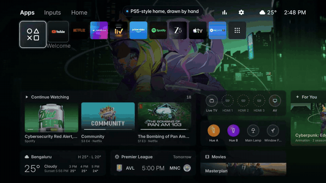
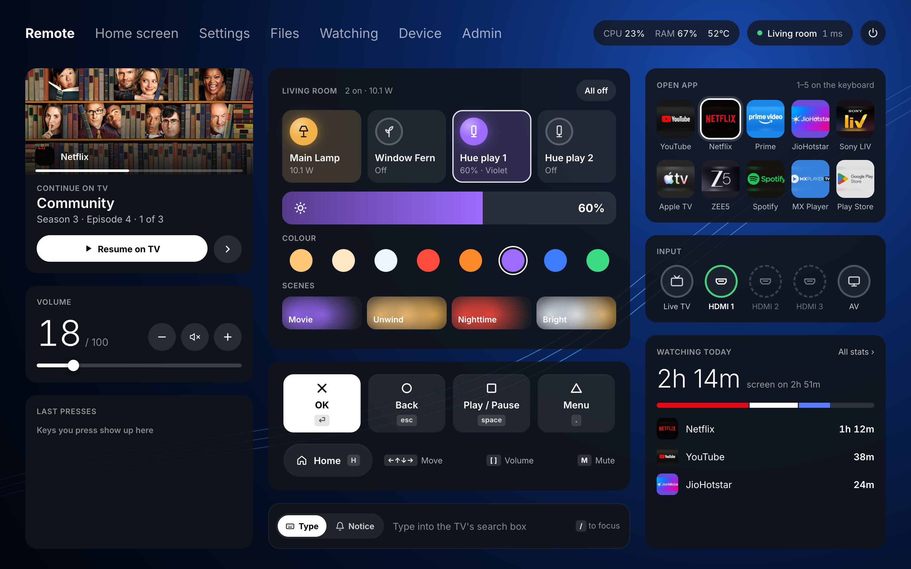

# Argon

A debloated Xiaomi Google TV with a PlayStation 5-style home screen, and a web remote the TV serves to any phone,
tablet or laptop on the Wi-Fi.

[](docs/media/argon_showcase.mp4)

▶ **[Watch the 30-second showcase with sound (MP4, 11 MB)](docs/media/argon_showcase.mp4)**

|                                                                                      |                                                                                       |
| ------------------------------------------------------------------------------------ | ------------------------------------------------------------------------------------- |
| [](launcher/README.md)            | [](launcher/README.md)         |
| **Launcher:** the Welcome hub (Continue Watching, inputs, picks, weather, the match) | **Launcher:** an app's hub, with the show you're partway through                      |
| [](remote/README.md)   | [](launcher/README.md) |
| **Remote:** the laptop layout, with the room's lights and plugs                      | **Launcher:** a Hue light, controlled over the LAN                                    |

## What's in this repo

| Folder                       | What                                                                                                                                                                                                                             |
| ---------------------------- | -------------------------------------------------------------------------------------------------------------------------------------------------------------------------------------------------------------------------------- |
| [`launcher/`](launcher/)     | The home screen app (`com.argon.launcher`): Java, no libraries, minSdk 34. Also runs the web remote's server, the viewing stats, notices over any app and the lights and plugs. **[Read the launcher docs](launcher/README.md)** |
| [`remote/`](remote/)         | The web remote's page for phone, tablet and laptop (`remote/public`), built into the launcher's APK and served by the TV on port 7777. **[Read the remote docs](remote/README.md)**                                              |
| [`tools/`](tools/)           | Shell scripts that drive the TV over adb: build and install, debloat and restore, notices, screenshots, plus the asset generators.                                                                                               |
| [`backup/`](backup/)         | `disabled_by_tools.txt`, the running list of every package the tools disabled, which `tools/restore.sh` reads. (The full device snapshot taken before any change stays on the Mac; it isn't in the repo.)                        |
| [`docs/media/`](docs/media/) | The showcase video.                                                                                                                                                                                                              |

| Script                                                | What                                                                                                                                                                     |
| ----------------------------------------------------- | ------------------------------------------------------------------------------------------------------------------------------------------------------------------------ |
| `tools/build_install.sh`                              | Builds the launcher, installs it, grants its permissions, makes it the default home and screensaver.                                                                     |
| `tools/restore.sh`                                    | Re-enables everything (or just the packages you name) and brings back the stock home.                                                                                    |
| `tools/disable.sh pkg…`                               | Disables packages one `pm` call at a time and logs them for restore; persistent packages are uninstalled for user 0 instead (the system starts them even when disabled). |
| `tools/notice.sh [-t title] [-s secs] text`           | Shows a notice card on the TV, on top of whatever app is open (see [Notices](launcher/README.md#notices-over-any-app)).                                                  |
| `tools/shot.sh name [KEY…]`                           | Presses remote keys over ADB (`DPAD_DOWN`, `HOME`, `BACK`…) and saves `shots/name.png`.                                                                                  |
| `tools/make_symbols.py font.ttf font.codepoints out/` | Renders the home screen's icons (white PNGs in `assets/symbols`) from the Material Symbols Rounded font (needs `Pillow`).                                                |
| `tools/make_loop.py in out.ogg start len`             | Cuts a seamless, loudness-matched loop from a nature recording (needs `numpy`, `scipy`, `soundfile`, `ffmpeg`).                                                          |

All scripts read the TV address from `TV` (default `192.168.2.13:5555`): `TV=192.168.2.50:5555 tools/restore.sh`.

## Quick start

1. On the TV: **Settings › System › About**, press OK on **Android TV OS build** seven times, then turn on
   **Developer options › USB debugging** and **Network debugging**. Note the TV's address.
2. On the Mac: JDK 17, the Android SDK and `adb` (see [Building on another machine](#building-on-another-machine)).
3. Optional, for the picks and the screensaver photos: a free TMDB key in `launcher/secrets.properties`
   (see [The TMDB key](launcher/README.md#the-tmdb-key)).
4. Build, install and make it the home screen:

   ```bash
   git clone https://github.com/abhinav-adtechs/argon.git && cd argon
   adb connect 192.168.2.13:5555
   TV=192.168.2.13:5555 tools/build_install.sh
   ```

   Accept **Allow USB debugging?** on the TV (tick **Always allow**). It asks a second time once the launcher's web
   remote connects to the TV's own adbd.

5. Open **`http://argon.local:7777`** on a phone, tablet or laptop on the same Wi-Fi, and set a password with the
   code the TV shows.

The debloat is separate: `tools/disable.sh` with the packages listed below. `tools/restore.sh` undoes all of it and
brings back the stock Google TV home.

## The TV

Device: Xiaomi **MiTV-MZTU0** (`river`), Google TV on Android 14, 1.8 GB RAM, at `192.168.2.13:5555`.
Every change is reversible. Nothing was removed from the system image: packages were disabled for user 0, except four
persistent ones that the system starts even when disabled, which were uninstalled for user 0 only (see [Boot](#boot)).

## What was disabled (44 packages)

- **Telemetry / analytics:** `com.miui.tv.analytics`, `com.xiaomi.statistic`, `com.xiaomi.tvqs.overseas.y24` (log uploader), `com.google.android.feedback`, `com.android.adservices.api`, `com.android.federatedcompute.services`, `com.android.ondevicepersonalization.services`
- **Xiaomi content and ads:** `com.mitv.tvhome.atv` (PatchWall), `com.mitv.tvhome.michannel`, `com.mitv.tvhome.mitvplus`, `com.mitv.tvhome.oemtab` (Mi Home tab), `com.xm.webcontent`, `android.autoinstalls.config.google.gtvpai` (Play auto-installs)
- **Background services:** `com.xiaomi.mi_connect_service`, `com.xiaomi.mitv.tvmanager` (cleaner), `com.xiaomi.mitv.manualhelp`,
  `com.mediatek.browservice` (MediaTek's HbbTV web service for broadcast TV, ~13 MB from boot; persistent, so uninstalled for user 0)
- **Your choices:** YouTube Music, Chromecast (`com.google.android.apps.mediashell`, `com.mediatek.dialservice`), AirPlay (3 × `com.mediatek.*airplay*`), Miracast/Smart Share (`com.xiaomi.wfdsinkhelperservice`, `com.xiaomi.mitv.smartshare`), firmware updates (`com.xiaomi.mitv.updateservice`, `com.mediatek.tv.systemupdater`, `com.mitv.upgrader`), ambient screensaver (`com.google.android.apps.tv.dreamx`; the launcher has its own now), USB media apps (`com.mitv.gallery`, `com.xiaomi.mimusic2`, `com.xiaomi.mitv.mediaexplorer`, `com.mitv.videoplayer`), Play Games
- **Started at every boot for nothing:** `com.android.dynsystem` (installs test system images), `com.android.managedprovisioning`
  (work profiles), `com.android.healthconnect.controller`, `com.android.tv.feedbackconsent`, `com.google.android.partnersetup`
  (RLZ ping), `com.android.printspooler`, calendar sync (`com.google.android.syncadapters.calendar`, `com.android.providers.calendar`)
- **For the new launcher:** `com.google.android.apps.tv.launcherx` (stock Google TV home) and `com.google.android.tungsten.setupwraith` (see below)

Kept on purpose: Google Assistant, Netflix, Prime Video, YouTube, Live TV and tuner inputs, `com.mediatek.tis` (HDMI inputs), `com.mitv.overseaservice` (Bluetooth remote), `mitv.service` (remote keys), `com.xiaomi.mitv.scenemode` (game mode), Play Store, Google Play services.

### Why setupwraith is disabled

Google TV chooses the HOME app by intent-filter priority **before** looking at the user's chosen default.
The stock launcher has priority 2, setupwraith's `RecoveryActivity` has 1, and a third-party launcher can't go above 0,
so `cmd package set-home-activity` alone is ignored. Shell isn't allowed to disable just that one activity, so the whole
setup-wizard package is off. It's only needed for first-time setup; a factory reset re-enables everything anyway.

## Boot

Measured from `logcat -b events` after `adb reboot` (seconds since the kernel started):

| s     | What                                                                                                                |
| ----- | ------------------------------------------------------------------------------------------------------------------- |
| 0–7   | Kernel, `init`, vendor HALs (MediaTek audio, tuner, Wi-Fi driver); boot animation starts at 11 s                    |
| 7.3   | Zygote starts; preloading classes and resources takes 1.7 s                                                         |
| 12    | `system_server`; package manager scan 14–17 s; activity manager ready at ~20 s                                      |
| 20–24 | System UI, Bluetooth, remote services, Assistant, Play services, tuner and HDMI inputs start                        |
| 24    | User unlocked; the launcher is started as HOME                                                                      |
| ~25   | Launcher's first frame, 1.3 s after it starts (the CPU is saturated: load average ~27)                              |
| 26–27 | Boot animation stops, home is on screen, `BOOT_COMPLETED` is sent                                                   |
| 27–60 | Every app with a boot receiver wakes up: Netflix, Prime, Hotstar, YouTube, Sony LIV, Apple TV, Spotify, Play Store… |

Everything up to 24 s is the firmware and can't be changed without root. The launcher's first frame is the one part on
this path that's ours, so it's a release build: ART runs a debuggable app without compiled code, and the debug build
took ~1.3 s to its first frame on an idle TV (3–4.5 s during boot) against ~0.5 s (1.3 s during boot) for release, so
home is on screen about 2 s sooner. Without `run-as` (debug builds only), adb reads the launcher's viewing database
through its `FilesProvider` (`content read`, shell only).

The apps that wake at 27–60 s don't delay the home screen but keep the TV sluggish for the first half-minute. The
streaming apps' boot receivers are kept: they reschedule the jobs that publish Continue Watching.

`pm disable-user` doesn't stop **persistent** apps: the activity manager starts them at boot anyway (they showed as
`*PERS*` in `dumpsys activity processes`, ~20 MB together). `com.mediatek.partner.airplay_sys`,
`com.mediatek.airplaydaemon`, `com.mediatek.dialservice` and `com.mediatek.browservice` are therefore uninstalled for user 0 with
`pm uninstall -k --user 0`; the APKs stay in `/system` and `tools/restore.sh` brings them back with
`cmd package install-existing`. `com.android.devicelockcontroller` (for financed devices) would be next, but it's a
protected package and shell can't disable it.

To measure a boot yourself: `adb reboot`, wait, then
`adb logcat -b events -d | grep -E "boot_progress|sf_stop_bootanim|wm_activity_launch_time|am_proc_start"`.

## Re-enable an app

```bash
tools/restore.sh com.google.android.youtube.tvmusic
```

Or directly: `adb -s 192.168.2.13:5555 shell pm enable --user 0 <package>` (for the three persistent AirPlay/DIAL
packages, run `cmd package install-existing --user 0 <package>` first). Package names are in the list above or in
`backup/disabled_by_tools.txt`. To undo everything and return to the stock Google TV home: `tools/restore.sh`.

**Before a firmware update:** run `tools/restore.sh com.xiaomi.mitv.updateservice com.mediatek.tv.systemupdater com.mitv.upgrader`,
check for updates in Settings, then disable them again with `tools/disable.sh` and the same names.

## Building on another machine

Needs JDK 17 and the Android SDK (`platforms;android-34`, `build-tools;34.0.0`) in `~/Library/Android/sdk`
(or set `ANDROID_HOME`). Gradle comes from the wrapper.

If `adb connect` fails with "No route to host" on macOS while the port is open, macOS Local Network privacy is blocking
adb: use the Python `adb-shell` package as the client instead (on this Mac stock adb worked). On this Mac it happens
when the adb daemon was started from inside the Claude app; `adb kill-server` and start it again from Terminal.app.

## Credits

- The layout follows the PlayStation 5's home screen and Welcome hub; nothing of Sony's is used (the glyphs, tiles and
  wallpaper are drawn in code). Not affiliated with or endorsed by Sony Interactive Entertainment.
- Parts of the code (the TMDB picks, the screensaver, the app tiles' logo lifting, and the unused glass shaders in
  `Scene`, `Shaders` and `Frost`) come from [Free My TV](https://github.com/simbasjungles/free-my-tv) (MIT); see
  `launcher/NOTICE`.
- This product uses the TMDB API but is not endorsed or certified by [TMDB](https://www.themoviedb.org/).
- Weather by [Open-Meteo.com](https://open-meteo.com/) (CC BY 4.0). Match data: ESPN's public scores feed.
- Font: [Inter](https://rsms.me/inter/) (SIL OFL 1.1). Icons: [Material Symbols](https://fonts.google.com/icons) (Apache 2.0).
