<p align="center"></p>

<p align="center">
  <a href="LICENSE"></a>
  
  
  <a href="https://github.com/abhinav-adtechs/argon/actions/workflows/ci.yml"></a>
  <a href="https://github.com/abhinav-adtechs/argon/commits/main"></a>
  <a href="https://github.com/abhinav-adtechs/argon/stargazers"></a>
  <a href="CONTRIBUTING.md"></a>
</p>

<p align="center"><b>A debloated Xiaomi Google TV with a PlayStation 5-style home screen, and a web remote the TV serves to any phone, tablet or laptop on the Wi-Fi.</b></p>

<p align="center">
  <a href="#features">Features</a> ·
  <a href="#quick-start">Quick start</a> ·
  <a href="#architecture">Architecture</a> ·
  <a href="#docs">Docs</a> ·
  <a href="#roadmap">Roadmap</a> ·
  <a href="#contributing">Contributing</a>
</p>

<p align="center">
  <a href="docs/media/argon_showcase.mp4">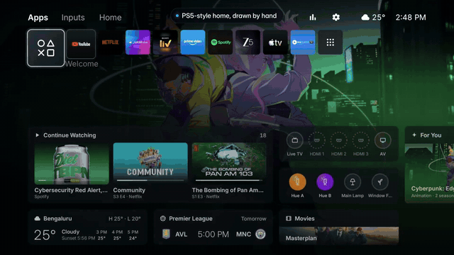</a>
</p>

<p align="center">▶ <b><a href="docs/media/argon_showcase.mp4">Watch the 30-second showcase with sound (MP4, ~11 MB)</a></b></p>

> [!WARNING]
> Argon was built for, and tested on, one TV: a Xiaomi **MiTV-MZTU0** (`river`) running Google TV on Android 14. The
> debloat disables system packages over adb; on another model the package names and side effects may differ. Every
> change is reversible (`tools/restore.sh` undoes it, and a factory reset re-enables everything anyway), but read
> [What was disabled](#what-was-disabled-44-packages) before you run `tools/disable.sh`.

## Why Argon?

The stock Xiaomi Google TV ships with PatchWall, Xiaomi's telemetry and content services, Play auto-installs and a
long tail of services that start at every boot, on a TV with 1.8 GB of RAM. Argon turns 44 of those packages off for
user 0 (nothing is removed from the system image), replaces the home screen with a PS5-style launcher written in plain
Java with no libraries, and makes the TV host its own web remote, so nothing has to run on a computer. After the
debloat the TV has ~590 MB of free RAM instead of ~540 MB, with ~15 fewer background processes.

## Screenshots

|                                                                                      |                                                                                       |
| ------------------------------------------------------------------------------------ | ------------------------------------------------------------------------------------- |
| [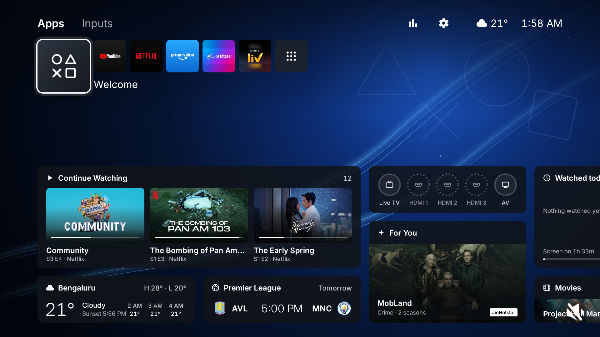](launcher/README.md)            | [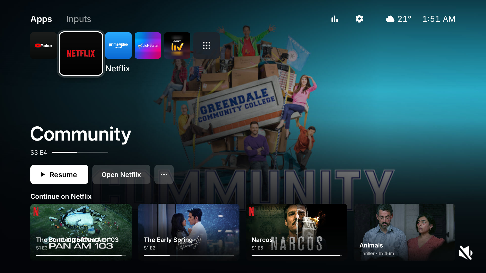](launcher/README.md)         |
| **Launcher:** the Welcome hub (Continue Watching, inputs, picks, weather, the match) | **Launcher:** an app's hub, with the show you're partway through                      |
| [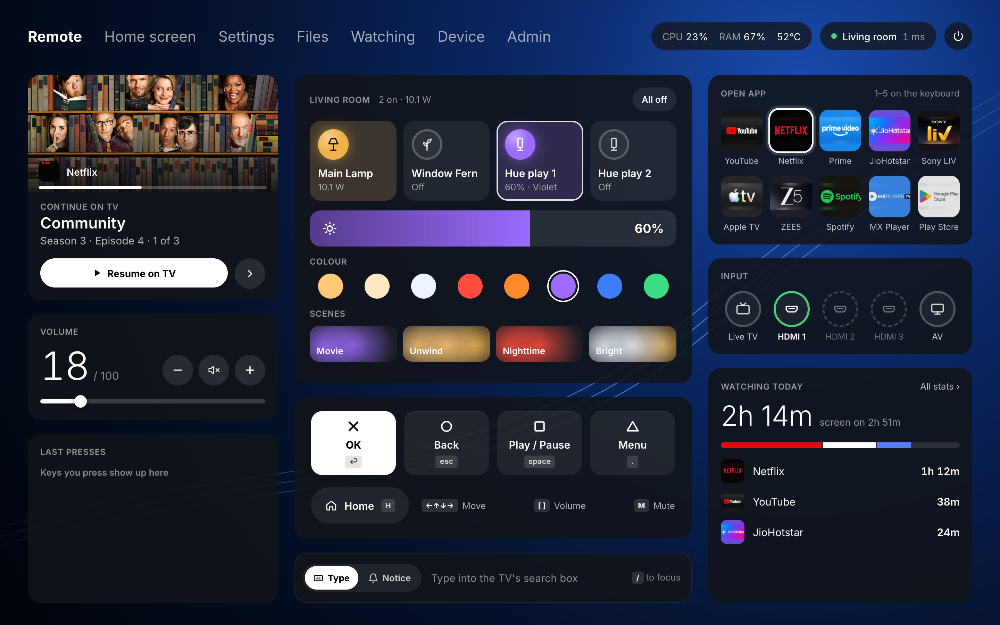](remote/README.md)   | [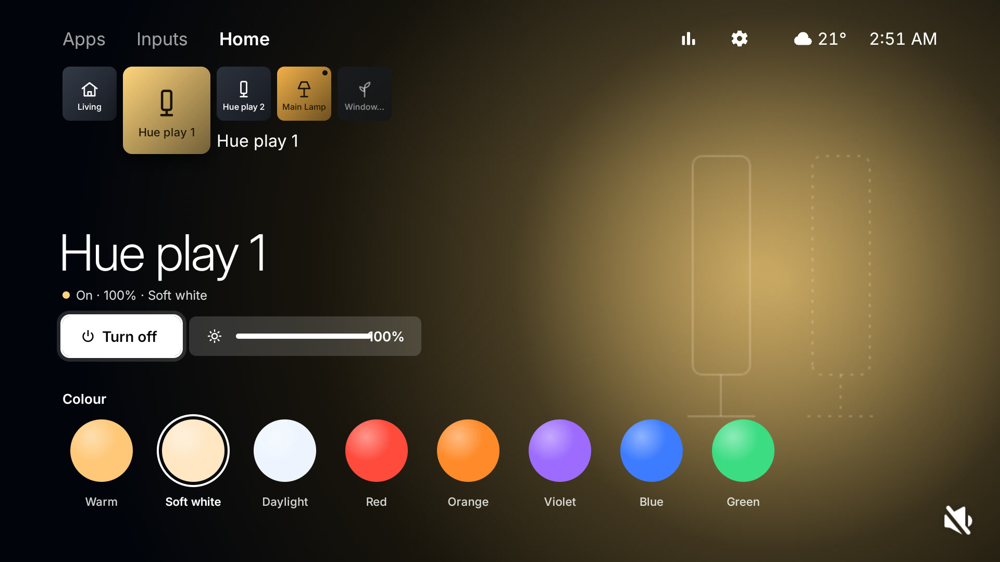](launcher/README.md) |
| **Remote:** the laptop layout, with the room's lights and plugs                      | **Launcher:** a Hue light, controlled over the LAN                                    |
| [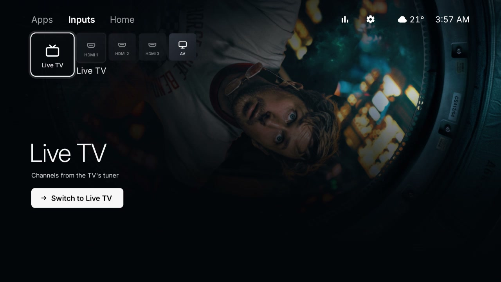](launcher/README.md)              | [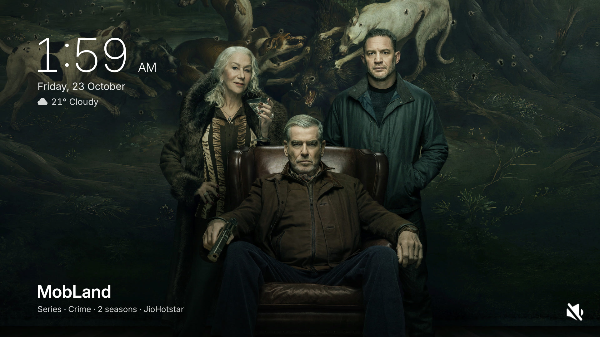](launcher/README.md)             |
| **Launcher:** Live TV, HDMI 1–3 (dimmed when nothing is plugged in) and AV           | **Screensaver:** the picks' photos with a slow zoom, the clock, date and weather      |
| [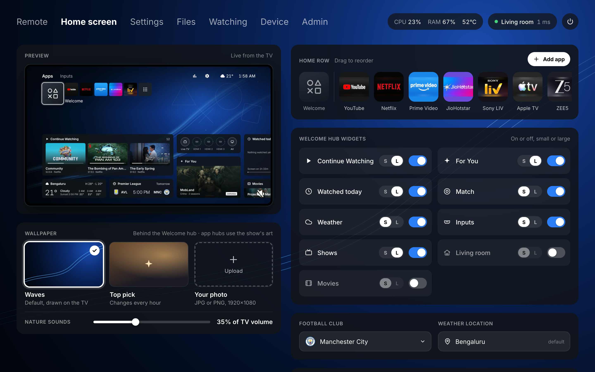](remote/README.md)     | [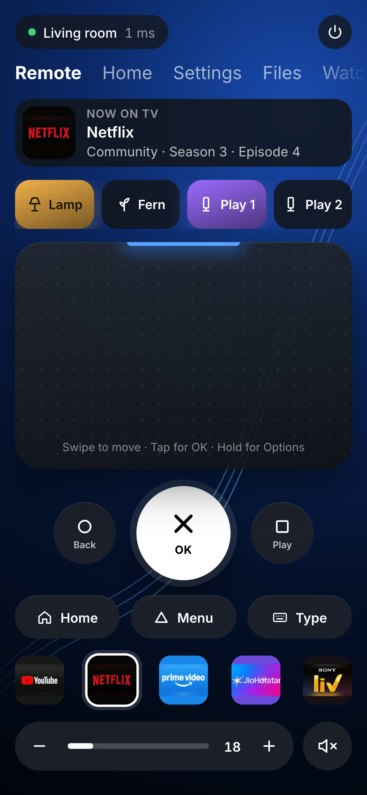](remote/README.md)               |
| **Remote:** the Home screen tab edits the launcher live                              | **Remote:** the phone layout, with the touch surface                                  |

<details>
<summary><b>In motion, and more screenshots</b></summary>

<br>

| Home screen                                                                                              | Web remote on a phone                                                                          |
| -------------------------------------------------------------------------------------------------------- | ---------------------------------------------------------------------------------------------- |
| [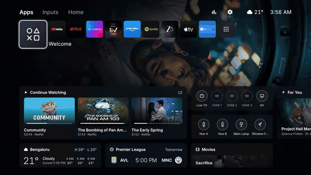](launcher/docs/media/home_motion.mp4) | [](remote/docs/media/remote_phone.mp4) |
| ▶ [MP4, 21 s](launcher/docs/media/home_motion.mp4): along the row, app hubs, the Inputs tab              | ▶ [MP4, 13 s](remote/docs/media/remote_phone.mp4): swipes, tap for OK, a plug, a light's sheet |

[](remote/docs/media/remote_laptop.mp4)

▶ [Laptop walkthrough, MP4, 27 s](remote/docs/media/remote_laptop.mp4): keys, a light, its colour, then the other tabs

|                                                                                             |                                                                                |
| ------------------------------------------------------------------------------------------- | ------------------------------------------------------------------------------ |
| 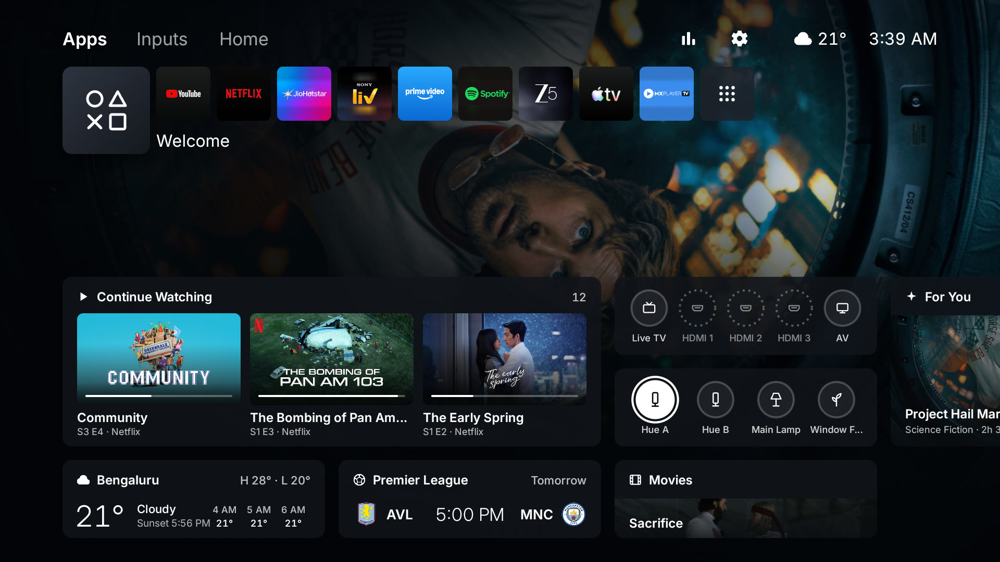 | 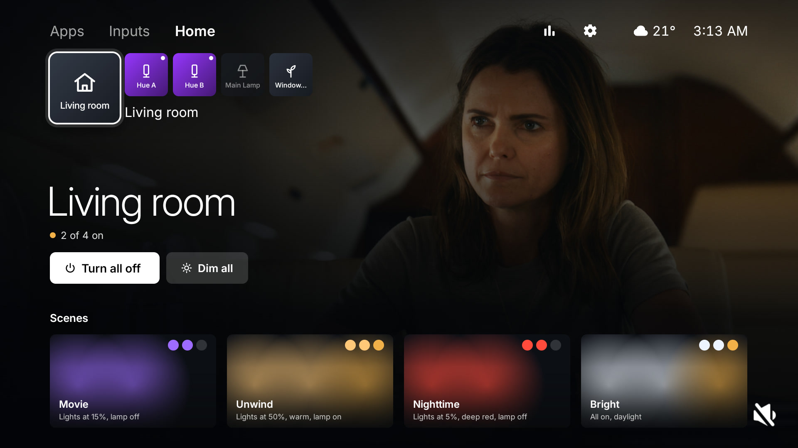                 |
| **Welcome hub:** the Living room widget, a ring per light and plug                          | **Home tab:** the room, Turn all off, Dim all and four scenes                  |
| 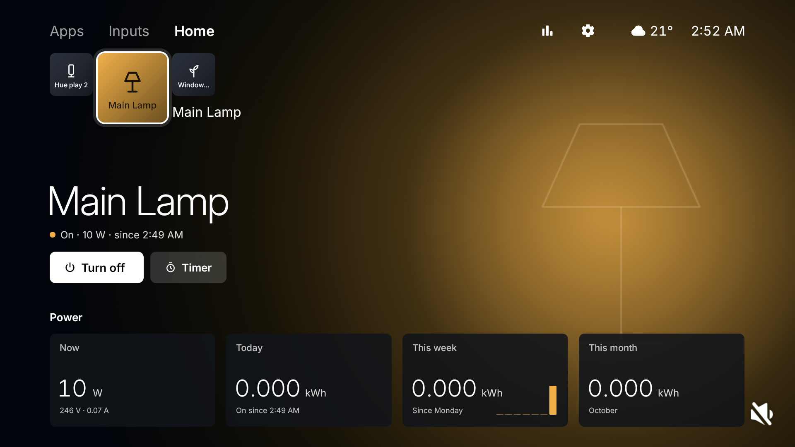                                           | 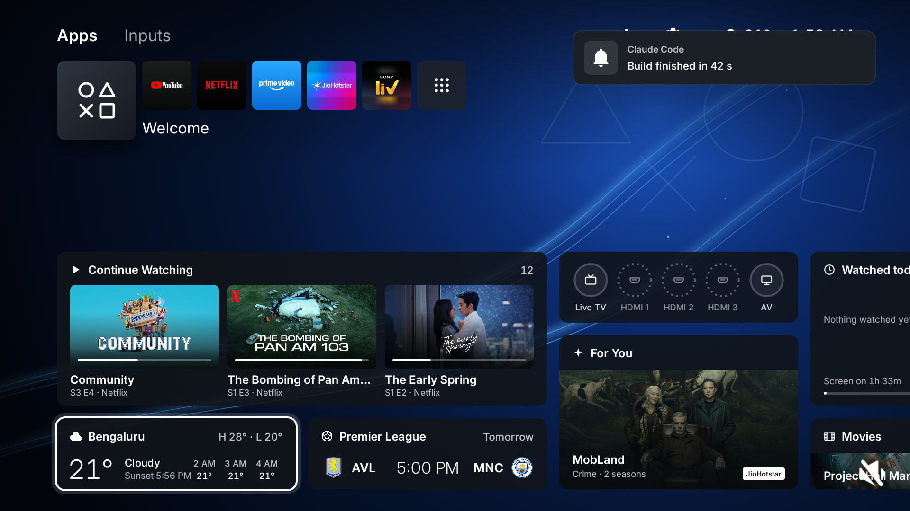                         |
| **A plug:** on/off, a timer, and its power now, today, this week and this month             | **Notice:** a card top right over whatever is on screen, posted over adb       |
| 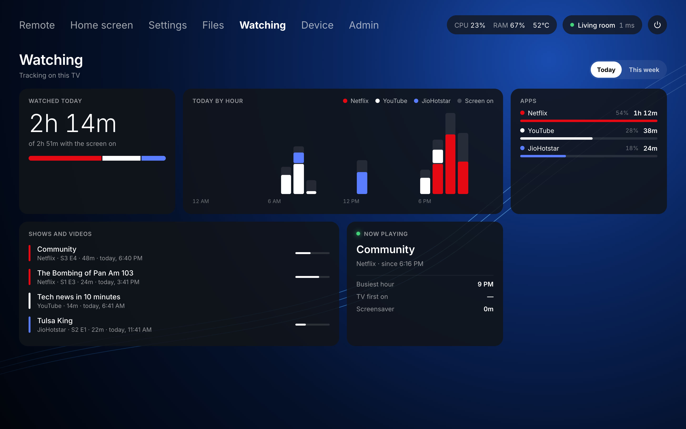                                      | 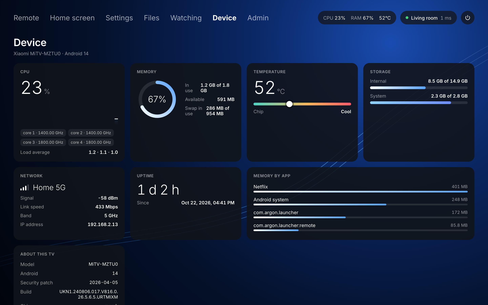                             |
| **Remote › Watching:** today or this week, by hour or day, apps and shows                   | **Remote › Device:** CPU, memory, temperature, storage, Wi-Fi, top apps, build |
| 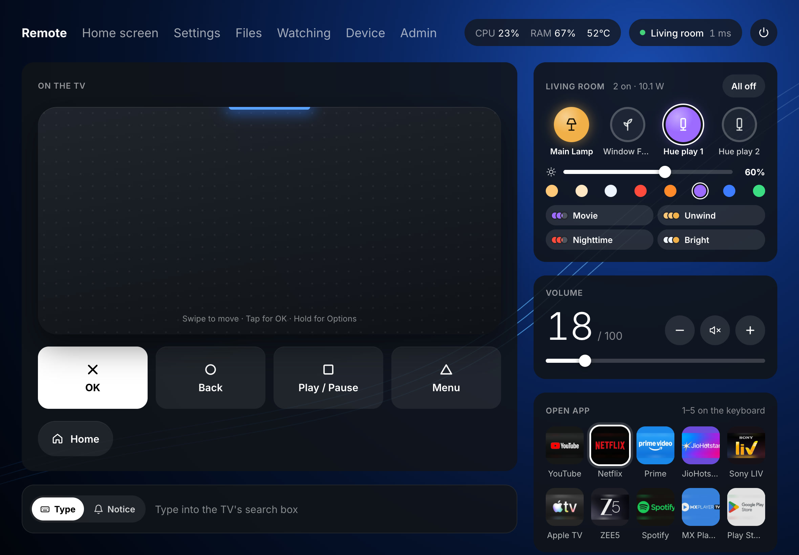                                       | 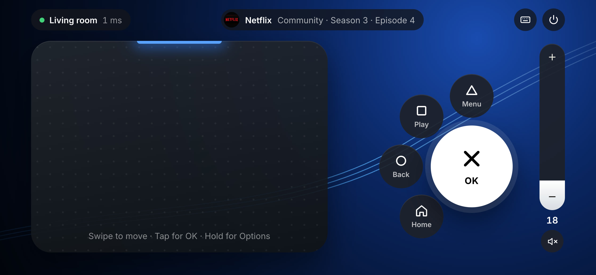   |
| **Remote:** the tablet layout                                                               | **Couch mode:** a phone held sideways, buttons in a fan for the right thumb    |

The remote's screenshots were taken from the page in `remote/public` against a local stand-in for the TV's API, with a
frame from the TV as its picture; the numbers and names in them are examples.

</details>

## Features

<table>
<tr>
<td width="50%" valign="top">

### 🎮 PS5-style home screen

- Four tabs (**Apps**, **Inputs**, **Home**, **Football Central**) over a row of square tiles; the focused tile grows, gets a white ring and its name
- **Welcome hub** widgets: Continue Watching from Netflix, Prime Video, Hotstar and Apple TV, weather, the match, inputs, the room, picks, _Watched today_
- **App hubs** with the show you're partway through, **Resume**, and more picks from that app
- Drawn by hand on one Canvas; no Sony artwork. Motion is quick and without overshoot, 59–60 fps along the row

</td>
<td width="50%" valign="top">

### 📱 A web remote the TV serves itself

- **`http://argon.local:7777`** on any phone, tablet or laptop on the Wi-Fi; nothing runs on a computer
- Phone, couch, tablet and laptop layouts; touch surface, keyboard shortcuts and **gamepad** (e.g. a DualSense)
- Keys through a virtual `uinput` remote over the TV's own adbd: 1–2 ms on the adb leg instead of ~140 ms per `input keyevent`
- **Remote**, **Home screen**, **Settings**, **Files**, **Watching**, **Device** and **Admin** tabs, plus the live TV picture on a laptop

</td>
</tr>
<tr>
<td valign="top">

### ⚽ Football Central

- A fourth tab with the club's season from ESPN's public API, no key (Manchester City by default)
- Match centre with lineups on a pitch an hour before kick-off, live score, goals, cards and stats
- News with an on-TV reader, transfer talk, form, fixtures, league and Champions League tables, cups
- **Watch on** opens the app that shows the match; the screensaver gets a City brief

</td>
<td valign="top">

### 💡 Lights and plugs, no cloud

- Philips Hue over the bridge's local API (CLIP v2 over HTTPS, certificate pinned): ~150 ms a command
- Tuya Wi-Fi plugs over the local protocol 3.3 (AES-128 on TCP 6668): ~90 ms a command
- Changes made in Google Home, the Hue app or on the plug show on the TV and every open remote at once
- Scenes (Movie, Unwind, Nighttime, Bright), dimming, colours, plug timers and energy per day

</td>
</tr>
<tr>
<td valign="top">

### 📊 Viewing stats

- Time per app, screen on/off and what played, today and this week, kept on the TV in `watch.db`
- Netflix and Prime Video time split across the titles they update in Continue watching
- On the TV (**Your Viewing**), in the remote's **Watching** tab, and as JSON over adb

</td>
<td valign="top">

### 🔔 Notices over any app

- `tools/notice.sh "Build finished"` puts a card top right over Netflix, YouTube or an HDMI input
- It never takes focus, so the remote keeps controlling the app underneath
- Only adb can post one: the receiver requires the `DUMP` permission

</td>
</tr>
<tr>
<td valign="top">

### 🧹 Reversible debloat

- 44 packages off for user 0: telemetry, Xiaomi content and ads, background services, boot-time stragglers
- Persistent packages are uninstalled for user 0 only; the APKs stay in `/system`
- `tools/restore.sh` brings back any package, or everything and the stock Google TV home

</td>
<td valign="top">

### 🔐 Locked down by default

- Setting the password takes a 6-digit code shown on the TV, so only someone in the room can do it
- PBKDF2-SHA256 (200,000 rounds), per-device `HttpOnly` cookies, lockouts that double up to 15 min
- **Admin** tab: signed-in devices, sign-out, and a history of what each device did

</td>
</tr>
</table>

Also: wake the TV from standby from a laptop or the remote's power button, a screensaver with the picks' photos, a
quiet click on focus moves, and a launcher that sits at ~62 MB PSS on the home screen.

## Tech stack

**TV app**


**Web remote**


**Tools and services**


## Architecture

One APK, two processes. The main process is the home screen; the `:remote` process is a foreground service that
serves the web remote, holds the adb link to the TV's own adbd, and owns the connections to the lights and plugs.

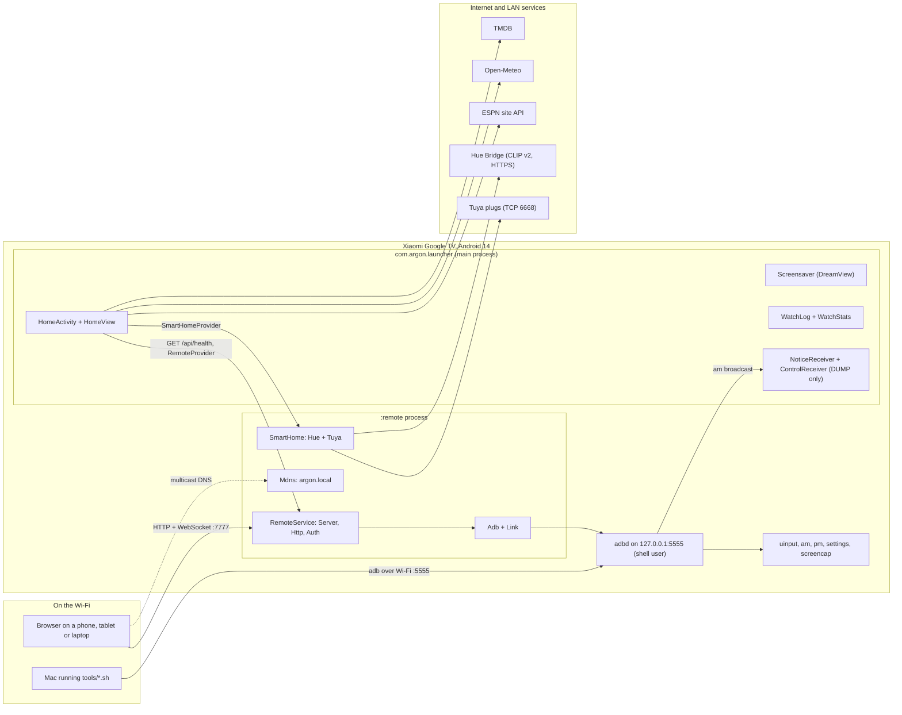

The remote's page (`remote/public`) is copied into the APK by the `copyRemoteAssets` Gradle task and served from
`assets/remote`. Nearly everything it does needs the shell user, so the server talks to the TV's own adbd over loopback
with a small adb client and its own RSA key. See [docs/ARCHITECTURE.md](docs/ARCHITECTURE.md) for the processes,
components, data flows and on-device storage.

## Quick start

**You need:** a Google TV you can put in developer mode (Argon was built on a Xiaomi MiTV-MZTU0), a Mac with JDK 17,
the Android SDK (`platforms;android-34`, `build-tools;34.0.0`) and `adb`. Gradle comes from the wrapper.

1. On the TV: **Settings › System › About**, press OK on **Android TV OS build** seven times, then turn on
   **Developer options › USB debugging** and **Network debugging**. Note the TV's address.
2. On the Mac: JDK 17, the Android SDK and `adb` (see [Building on another machine](#building-on-another-machine)).
3. Optional, for the picks and the screensaver photos: a free TMDB key in `launcher/secrets.properties`
   (see [The TMDB key](launcher/README.md#the-tmdb-key)).
4. Build, install and make it the home screen:

   ```bash
   git clone https://github.com/abhinav-adtechs/argon.git && cd argon
   adb connect 192.168.2.14:5555
   TV=192.168.2.14:5555 tools/build_install.sh
   ```

   Accept **Allow USB debugging?** on the TV (tick **Always allow**). It asks a second time once the launcher's web
   remote connects to the TV's own adbd.

5. Open **`http://argon.local:7777`** on a phone, tablet or laptop on the same Wi-Fi, and set a password with the
   code the TV shows.

> [!NOTE]
> The debloat is a separate step: `tools/disable.sh` with the packages listed [below](#what-was-disabled-44-packages).
> `tools/restore.sh` undoes all of it and brings back the stock Google TV home.

## Configuration

| Name              | Where                                         | Default                                                   | What it does                                                                                             |
| ----------------- | --------------------------------------------- | --------------------------------------------------------- | -------------------------------------------------------------------------------------------------------- |
| `TV`              | Environment, every script in `tools/`         | `192.168.2.14:5555`                                       | The TV's adb address: `TV=192.168.2.50:5555 tools/restore.sh`                                            |
| `ANDROID_HOME`    | Environment, `tools/build_install.sh`         | `~/Library/Android/sdk`                                   | The Android SDK; written to `launcher/local.properties`                                                  |
| `JAVA_HOME_17`    | Environment, `tools/build_install.sh`         | macOS's `java_home -v 17`                                 | The JDK 17 to build with                                                                                 |
| `tmdb_key`        | `launcher/secrets.properties` (gitignored)    | empty                                                     | TMDB API Read Access Token or API key. Without it, everything but the picks and screensaver photos works |
| `tmdb_region`     | `launcher/secrets.properties`                 | `IN`                                                      | Which country's streaming catalogue the picks come from                                                  |
| `dock_packages`   | `launcher/app/src/main/res/values/config.xml` | YouTube, Netflix, Prime Video, JioHotstar, Sony LIV       | The starting Home row                                                                                    |
| `football_team`   | `config.xml`                                  | `382` (Manchester City)                                   | ESPN team id; empty hides Football Central, the LIVE pill and the match widget                           |
| `football_watch`  | `config.xml`                                  | `eng.1\|in.startv.hotstar`, `uefa.champions\|com.sonyliv` | The app **Watch on** opens, per competition                                                              |
| `live_tv_package` | `config.xml`                                  | `com.mitv.livetv`                                         | The Live TV app on the Inputs tab                                                                        |

The widgets, their order and size, the wallpaper, the club and the weather location are set live from the web
remote's **Home screen** tab. The full list of rebuild-time defaults is in
[Change the defaults](launcher/README.md#change-the-defaults-rebuild).

## Scripts

| Script                                                | What                                                                                                                                                                     |
| ----------------------------------------------------- | ------------------------------------------------------------------------------------------------------------------------------------------------------------------------ |
| `tools/build_install.sh`                              | Builds the launcher, installs it, grants its permissions, makes it the default home and screensaver.                                                                     |
| `tools/restore.sh`                                    | Re-enables everything (or just the packages you name) and brings back the stock home.                                                                                    |
| `tools/disable.sh pkg…`                               | Disables packages one `pm` call at a time and logs them for restore; persistent packages are uninstalled for user 0 instead (the system starts them even when disabled). |
| `tools/notice.sh [-t title] [-s secs] text`           | Shows a notice card on the TV, on top of whatever app is open (see [Notices](launcher/README.md#notices-over-any-app)).                                                  |
| `tools/shot.sh name [KEY…]`                           | Presses remote keys over ADB (`DPAD_DOWN`, `HOME`, `BACK`…) and saves `shots/name.png`.                                                                                  |
| `tools/wake.sh [secs]`                                | Turns the TV on from standby over ADB, retrying while it naps (needs Screenless mode, see [Waking the TV](#waking-the-tv-from-a-laptop)).                                |
| `tools/make_symbols.py font.ttf font.codepoints out/` | Renders the home screen's icons (white PNGs in `assets/symbols`) from the Material Symbols Rounded font (needs `Pillow`).                                                |

All scripts read the TV address from `TV` (default `192.168.2.14:5555`).

## The TV

Device: Xiaomi **MiTV-MZTU0** (`river`), Google TV on Android 14, 1.8 GB RAM, at `192.168.2.14:5555`.
Every change is reversible. Nothing was removed from the system image: packages were disabled for user 0, except four
persistent ones that the system starts even when disabled, which were uninstalled for user 0 only (see [Boot](#boot)).

### What was disabled (44 packages)

The running list is [`backup/disabled_by_tools.txt`](backup/disabled_by_tools.txt), which `tools/restore.sh` reads.

<details>
<summary><b>The full list, by reason</b></summary>

<br>

- **Telemetry / analytics:** `com.miui.tv.analytics`, `com.xiaomi.statistic`, `com.xiaomi.tvqs.overseas.y24` (log uploader), `com.google.android.feedback`, `com.android.adservices.api`, `com.android.federatedcompute.services`, `com.android.ondevicepersonalization.services`
- **Xiaomi content and ads:** `com.mitv.tvhome.atv` (PatchWall), `com.mitv.tvhome.michannel`, `com.mitv.tvhome.mitvplus`, `com.mitv.tvhome.oemtab` (Mi Home tab), `com.xm.webcontent`, `android.autoinstalls.config.google.gtvpai` (Play auto-installs)
- **Background services:** `com.xiaomi.mi_connect_service`, `com.xiaomi.mitv.tvmanager` (cleaner), `com.xiaomi.mitv.manualhelp`,
  `com.mediatek.browservice` (MediaTek's HbbTV web service for broadcast TV, ~13 MB from boot; persistent, so uninstalled for user 0)
- **Your choices:** YouTube Music, Chromecast (`com.google.android.apps.mediashell`, `com.mediatek.dialservice`), AirPlay (3 × `com.mediatek.*airplay*`), Miracast/Smart Share (`com.xiaomi.wfdsinkhelperservice`, `com.xiaomi.mitv.smartshare`), firmware updates (`com.xiaomi.mitv.updateservice`, `com.mediatek.tv.systemupdater`, `com.mitv.upgrader`), ambient screensaver (`com.google.android.apps.tv.dreamx`; the launcher has its own now), USB media apps (`com.mitv.gallery`, `com.xiaomi.mimusic2`, `com.xiaomi.mitv.mediaexplorer`, `com.mitv.videoplayer`), Play Games
- **Started at every boot for nothing:** `com.android.dynsystem` (installs test system images), `com.android.managedprovisioning`
  (work profiles), `com.android.healthconnect.controller`, `com.android.tv.feedbackconsent`, `com.google.android.partnersetup`
  (RLZ ping), `com.android.printspooler`, calendar sync (`com.google.android.syncadapters.calendar`, `com.android.providers.calendar`)
- **For the new launcher:** `com.google.android.apps.tv.launcherx` (stock Google TV home) and `com.google.android.tungsten.setupwraith` (see below)

</details>

**Kept on purpose:** Google Assistant, Netflix, Prime Video, YouTube, Live TV and tuner inputs, `com.mediatek.tis` (HDMI
inputs), `com.mitv.overseaservice` (Bluetooth remote), `mitv.service` (remote keys), `com.xiaomi.mitv.scenemode` (game
mode), Play Store, Google Play services.

### Why setupwraith is disabled

Google TV chooses the HOME app by intent-filter priority **before** looking at the user's chosen default.
The stock launcher has priority 2, setupwraith's `RecoveryActivity` has 1, and a third-party launcher can't go above 0,
so `cmd package set-home-activity` alone is ignored. Shell isn't allowed to disable just that one activity, so the whole
setup-wizard package is off. It's only needed for first-time setup; a factory reset re-enables everything anyway.

## Boot

Measured from `logcat -b events` after `adb reboot` (seconds since the kernel started):

<details>
<summary><b>Boot timeline, 0–60 s</b></summary>

<br>

| s     | What                                                                                                                |
| ----- | ------------------------------------------------------------------------------------------------------------------- |
| 0–7   | Kernel, `init`, vendor HALs (MediaTek audio, tuner, Wi-Fi driver); boot animation starts at 11 s                    |
| 7.3   | Zygote starts; preloading classes and resources takes 1.7 s                                                         |
| 12    | `system_server`; package manager scan 14–17 s; activity manager ready at ~20 s                                      |
| 20–24 | System UI, Bluetooth, remote services, Assistant, Play services, tuner and HDMI inputs start                        |
| 24    | User unlocked; the launcher is started as HOME                                                                      |
| ~25   | Launcher's first frame, 1.3 s after it starts (the CPU is saturated: load average ~27)                              |
| 26–27 | Boot animation stops, home is on screen, `BOOT_COMPLETED` is sent                                                   |
| 27–60 | Every app with a boot receiver wakes up: Netflix, Prime, Hotstar, YouTube, Sony LIV, Apple TV, Spotify, Play Store… |

</details>

Everything up to 24 s is the firmware and can't be changed without root. The launcher's first frame is the one part on
this path that's ours, so it's a release build: ART runs a debuggable app without compiled code, and the debug build
took ~1.3 s to its first frame on an idle TV (3–4.5 s during boot) against ~0.5 s (1.3 s during boot) for release, so
home is on screen about 2 s sooner. Without `run-as` (debug builds only), adb reads the launcher's viewing database
through its `FilesProvider` (`content read`, shell only).

The apps that wake at 27–60 s don't delay the home screen but keep the TV sluggish for the first half-minute. The
streaming apps' boot receivers are kept: they reschedule the jobs that publish Continue Watching.

`pm disable-user` doesn't stop **persistent** apps: the activity manager starts them at boot anyway (they showed as
`*PERS*` in `dumpsys activity processes`, ~20 MB together). `com.mediatek.partner.airplay_sys`,
`com.mediatek.airplaydaemon`, `com.mediatek.dialservice` and `com.mediatek.browservice` are therefore uninstalled for user 0 with
`pm uninstall -k --user 0`; the APKs stay in `/system` and `tools/restore.sh` brings them back with
`cmd package install-existing`. `com.android.devicelockcontroller` (for financed devices) would be next, but it's a
protected package and shell can't disable it.

To measure a boot yourself: `adb reboot`, wait, then
`adb logcat -b events -d | grep -E "boot_progress|sf_stop_bootanim|wm_activity_launch_time|am_proc_start"`.

## Waking the TV from a laptop

The web remote is served by the TV, so it's gone once the TV is off. Out of the box, standby here is a full shutdown:
suspend-to-RAM is off in this firmware (`persist.vendor.mitv.str.framework=false`), so the Wi-Fi goes off with
everything else and only the Bluetooth stays up, listening for the paired remote. Wake-on-LAN magic packets don't wake
it in any energy mode.

Two settings keep it on the network while it's asleep:

1. **Settings › System › Power & Energy › Power › Screenless mode:** on. In standby the TV keeps running with the
   screen off for up to 3 hours, then sleeps for real. (It's there for AirPlay and HomeKit, but works with the AirPlay
   packages uninstalled.)
2. **Settings › System › Power & Energy › Energy Modes:** **Optimized** (networked standby). Increased works too;
   on Low the TV still shuts down.

Then `tools/wake.sh` turns it on with `KEYCODE_WAKEUP` over ADB. Asleep, the TV drops off the Wi-Fi for seconds at a
time, so the script reconnects and retries until the TV reports it's awake (under a minute in testing; it gives up
after 90 s, or the seconds you pass).

| Screenless mode | Energy mode | After 1.5–2 min in standby       |
| --------------- | ----------- | -------------------------------- |
| off             | Increased   | Shut down, nothing wakes it      |
| on              | Low         | Shut down, nothing wakes it      |
| on              | Optimized   | Woken by `tools/wake.sh`         |
| on              | Increased   | Woken by `input keyevent WAKEUP` |

The web remote keeps running through those 3 hours too, and its power button turns the TV on (see
[While the TV is off](remote/README.md#how-it-works)).

> [!NOTE]
> Not yet tested: whether the TV can still be woken after the 3 hours are up. If `tools/wake.sh` gives up, the TV is
> fully off and only the remote or the TV's own button turns it on.

## Re-enable an app

```bash
tools/restore.sh com.google.android.youtube.tvmusic
```

Or directly: `adb -s 192.168.2.14:5555 shell pm enable --user 0 <package>` (for the three persistent AirPlay/DIAL
packages, run `cmd package install-existing --user 0 <package>` first). Package names are in the list above or in
`backup/disabled_by_tools.txt`. To undo everything and return to the stock Google TV home: `tools/restore.sh`.

> [!IMPORTANT]
> **Before a firmware update:** run
> `tools/restore.sh com.xiaomi.mitv.updateservice com.mediatek.tv.systemupdater com.mitv.upgrader`, check for updates
> in Settings, then disable them again with `tools/disable.sh` and the same names.

`tools/restore.sh` with no arguments also prints the last two steps for a full undo: uninstall `com.argon.launcher`,
then turn Low Power Standby back on (the web remote turns it off so it can stay on the network while the TV sleeps).

## Building on another machine

Needs JDK 17 and the Android SDK (`platforms;android-34`, `build-tools;34.0.0`) in `~/Library/Android/sdk`
(or set `ANDROID_HOME`). Gradle comes from the wrapper.

If `adb connect` fails with "No route to host" on macOS while the port is open, macOS Local Network privacy is blocking
adb: use the Python `adb-shell` package as the client instead (on this Mac stock adb worked). On this Mac it happens
when the adb daemon was started from inside the Claude app; `adb kill-server` and start it again from Terminal.app.

More fixes for things that go wrong (a black home after install, notices that stop showing, the web remote's red
banner) are in [docs/TROUBLESHOOTING.md](docs/TROUBLESHOOTING.md).

## Project structure

```text
argon/
├── launcher/                         The home screen app, com.argon.launcher (Gradle project)
│   ├── app/build.gradle              SDK 34, Java 17, release build; copies remote/public into the APK
│   ├── app/src/main/
│   │   ├── AndroidManifest.xml       Home activity, screensaver, :remote service, shell-only receivers and providers
│   │   ├── java/com/argon/launcher/
│   │   │   ├── HomeActivity, HomeView    The home screen, drawn by hand
│   │   │   ├── City, CityArt             Football Central (ESPN)
│   │   │   ├── Recs, Weather, Shows      TMDB picks, Open-Meteo weather, Continue Watching
│   │   │   ├── WatchLog, WatchStats      Viewing stats (watch.db)
│   │   │   ├── remote/                   The web remote's server, adb client, mDNS, auth
│   │   │   └── smarthome/                Philips Hue and Tuya plugs over the LAN
│   │   ├── res/values/config.xml     Defaults you change by rebuilding
│   │   └── assets/                   Inter font, Material Symbols icons
│   ├── NOTICE                        Third-party code and asset credits
│   └── README.md                     Launcher docs
├── remote/
│   ├── public/                       The web remote: index.html, login.html, app.js, views.js, app.css
│   └── README.md                     Web remote docs
├── tools/                            adb scripts: build and install, disable and restore, notice, shot, wake
├── backup/disabled_by_tools.txt      Every package the tools disabled (read by restore.sh)
└── docs/                             Architecture, troubleshooting, showcase media
```

## Docs

| Doc                                                | What's in it                                                                                                                     |
| -------------------------------------------------- | -------------------------------------------------------------------------------------------------------------------------------- |
| [launcher/README.md](launcher/README.md)           | The home screen in detail, the TMDB key, remote-control keys, defaults, notices, stats, lights and plugs, speakers, resource use |
| [remote/README.md](remote/README.md)               | The web remote: layouts, how it runs, password, every tab, how it changes the launcher                                           |
| [docs/ARCHITECTURE.md](docs/ARCHITECTURE.md)       | Processes, components, data flows, on-device storage, external services                                                          |
| [docs/TROUBLESHOOTING.md](docs/TROUBLESHOOTING.md) | Symptoms and fixes collected from across the docs                                                                                |
| [launcher/NOTICE](launcher/NOTICE)                 | Third-party code, fonts and icons                                                                                                |
| [CHANGELOG.md](CHANGELOG.md)                       | What changed in each release                                                                                                     |

## Roadmap

- [ ] Build the APK in CI and attach it to each release
- [ ] Let `tools/build_install.sh` run on Linux as well as macOS
- [ ] A `--dry-run` for `tools/disable.sh` and `tools/restore.sh`
- [ ] A tested-devices list, and a guide for debloating other Google TV models
- [ ] Football Central in the chosen club's colours, not only Manchester City's
- [ ] Find out whether the TV can still be woken after Screenless mode's 3 hours
- [ ] JVM unit tests for the pure-Java parts (colour palette, Tuya frames, password hashing)

## Contributing

Issues and pull requests are welcome. Start with [CONTRIBUTING.md](CONTRIBUTING.md) for the setup, the checks CI runs,
and how to test a change on a TV without losing your data.

## Credits

- The layout follows the PlayStation 5's home screen and Welcome hub; nothing of Sony's is used (the glyphs, tiles and
  wallpaper are drawn in code). Not affiliated with or endorsed by Sony Interactive Entertainment.
- Parts of the code (the TMDB picks, the screensaver, the app tiles' logo lifting, and the unused glass shaders in
  `Scene`, `Shaders` and `Frost`) come from [Free My TV](https://github.com/simbasjungles/free-my-tv) (MIT); see
  `launcher/NOTICE`.
- This product uses the TMDB API but is not endorsed or certified by [TMDB](https://www.themoviedb.org/).
- Weather by [Open-Meteo.com](https://open-meteo.com/) (CC BY 4.0). Match data: ESPN's public scores feed.
- Font: [Inter](https://rsms.me/inter/) (SIL OFL 1.1). Icons: [Material Symbols](https://fonts.google.com/icons) (Apache 2.0).

## License

[MIT](LICENSE) © 2026 Abhinav Das. Third-party code, the Inter font and the Material Symbols icons keep their own
licenses; see [launcher/NOTICE](launcher/NOTICE).

## Star history

<a href="https://star-history.com/#abhinav-adtechs/argon&Date"></a>

---

<p align="center">Built by <a href="https://github.com/abhinav-adtechs">Abhinav Das</a></p>
<p align="center">If this project helped you, consider giving it a ⭐</p>
