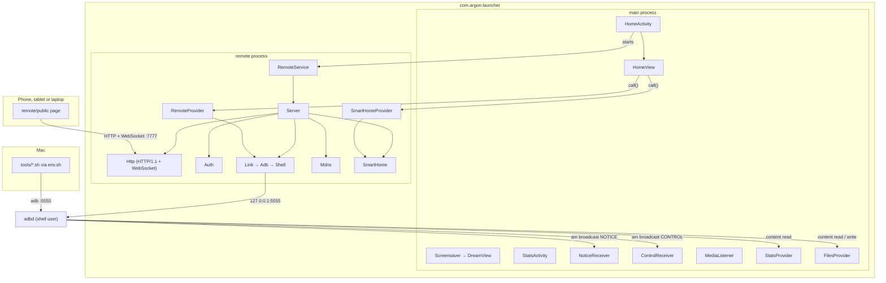
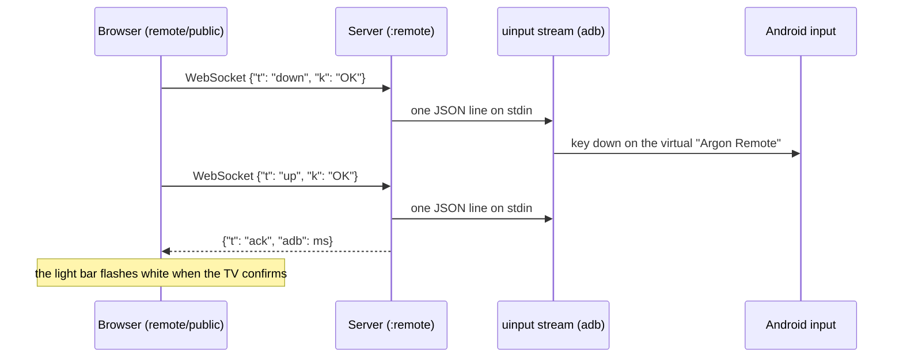
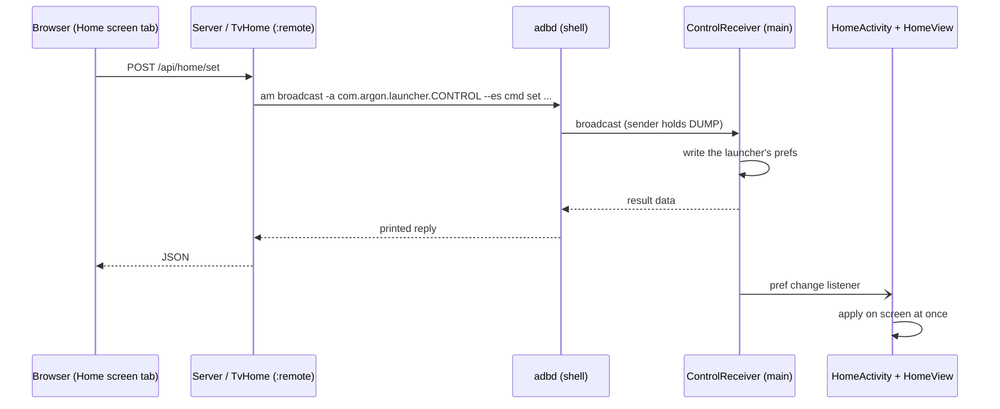
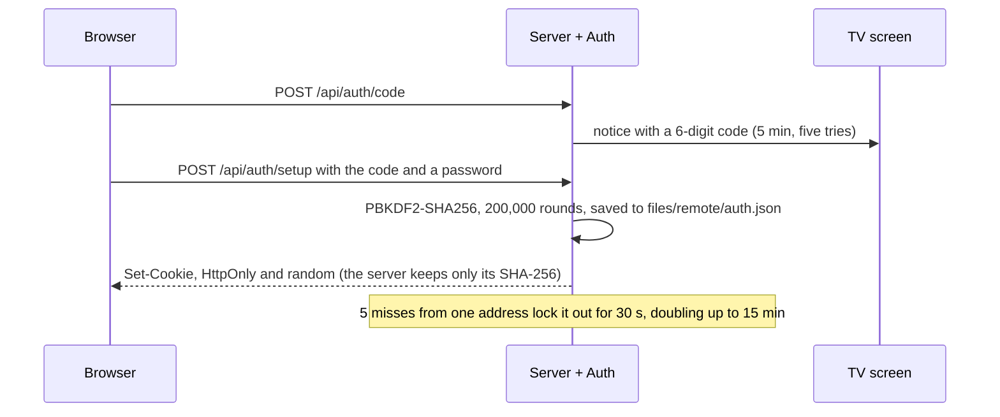
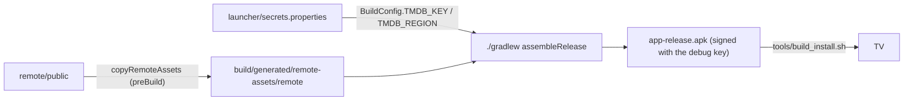

# Architecture

How Argon fits together: one Android app with two processes, a static web page it serves, and a handful of shell
scripts that drive the TV over adb. For what each screen does, see [launcher/README.md](../launcher/README.md) and
[remote/README.md](../remote/README.md); this page is about how the parts talk to each other.

- [The pieces](#the-pieces)
- [Components in the APK](#components-in-the-apk)
- [The main process: the home screen](#the-main-process-the-home-screen)
- [The `:remote` process: the web remote](#the-remote-process-the-web-remote)
- [Data flows](#data-flows)
- [Storage on the TV](#storage-on-the-tv)
- [External services](#external-services)
- [Build and install](#build-and-install)
- [Security model](#security-model)

## The pieces

| Piece                                               | Path                                                       | Runs on                  | Language                              |
| --------------------------------------------------- | ---------------------------------------------------------- | ------------------------ | ------------------------------------- |
| Launcher (home screen, screensaver, stats, notices) | `launcher/app/src/main/java/com/argon/launcher/`           | TV, main process         | Java 17, Android SDK 34, no libraries |
| Web remote server, adb client, mDNS, auth           | `launcher/app/src/main/java/com/argon/launcher/remote/`    | TV, `:remote` process    | Java                                  |
| Lights and plugs                                    | `launcher/app/src/main/java/com/argon/launcher/smarthome/` | TV, `:remote` process    | Java                                  |
| Web remote page                                     | `remote/public/` (copied into the APK as `assets/remote`)  | Any browser on the Wi-Fi | HTML, CSS, vanilla JS                 |
| Tools                                               | `tools/`                                                   | A Mac with `adb`         | Bash, one Python script               |

## Components in the APK

From [`AndroidManifest.xml`](../launcher/app/src/main/AndroidManifest.xml):

| Component           | Kind                              | Process   | Exported | Guarded by                           | Purpose                                                                          |
| ------------------- | --------------------------------- | --------- | -------- | ------------------------------------ | -------------------------------------------------------------------------------- |
| `HomeActivity`      | Activity (HOME)                   | main      | yes      | —                                    | The home screen; `HomeView` draws all of it                                      |
| `StatsActivity`     | Activity                          | main      | no       | —                                    | **Your Viewing**, the full-screen stats                                          |
| `Screensaver`       | DreamService                      | main      | yes      | `BIND_DREAM_SERVICE`                 | The picks' photos, clock, weather and the City panel                             |
| `MediaListener`     | NotificationListenerService       | main      | yes      | `BIND_NOTIFICATION_LISTENER_SERVICE` | Media sessions: what's playing, with titles                                      |
| `NoticeReceiver`    | Receiver                          | main      | yes      | `DUMP` (shell and root only)         | Cards over any app (`com.argon.launcher.NOTICE`)                                 |
| `ControlReceiver`   | Receiver                          | main      | yes      | `DUMP`                               | The web remote's way into the launcher's settings (`com.argon.launcher.CONTROL`) |
| `StatsProvider`     | Provider                          | main      | yes      | `DUMP` (read and write)              | `stats.json` for the web remote and adb                                          |
| `FilesProvider`     | Provider                          | main      | yes      | `DUMP` (read and write)              | `watch.db`, `smarthome.json` and wallpapers for adb                              |
| `RemoteService`     | Foreground service (`specialUse`) | `:remote` | no       | —                                    | Hosts the web remote on port 7777                                                |
| `SmartHomeProvider` | Provider                          | `:remote` | no       | —                                    | The lights and plugs for the home screen                                         |
| `RemoteProvider`    | Provider                          | `:remote` | no       | —                                    | The remote's adb link for the home screen (Bluetooth connect)                    |

Everything exported that can change state requires `DUMP`, which only the shell user and root hold, so other apps on
the TV can't post notices, change settings or read the stats.

## The main process: the home screen

`HomeActivity` feeds `HomeView` what the system and the web remote say; `HomeView` (about 4,800 lines) draws the tabs,
the row, the hubs, Options, All Apps and Football Central.

**Rendering.** Measured on the TV, redrawing while something moves is what drops frames; moving, scaling or fading
what's already drawn keeps up. So the screen is built from views that are drawn once and then only moved: each row
tile, its ring, its shadow and its name are separate views; each hub is drawn into a hardware layer once the row stops;
a focused button gets a small overlay that fades and grows instead of redrawing the hub; the background is two picture
views that cross-fade. Pictures are kept at 1280×720 in GPU memory with a 640×360 copy for cards. Nothing is drawn
while nothing moves. See [Resource use](../launcher/README.md#resource-use) for the measurements.

**Where the data comes from:**

| Class                    | Data                                                                     | Source                                                                   |
| ------------------------ | ------------------------------------------------------------------------ | ------------------------------------------------------------------------ |
| `Apps`, `Tiles`          | Home row, All Apps, inputs, brand tiles                                  | `PackageManager`, the TV input framework, `config.xml`                   |
| `Shows`, `Artwork`       | Continue Watching                                                        | Watch Next programs apps publish to the TV provider (`READ_TV_LISTINGS`) |
| `Recs`, `Backdrop`       | Picks for the hubs and the screensaver                                   | TMDB, filtered to the streaming apps installed                           |
| `Weather`                | Now, the next hours, sunrise and sunset                                  | Open-Meteo, no key                                                       |
| `City`, `CityArt`        | Football Central, the LIVE pill, the match widget, the screensaver panel | ESPN's public site API, no key                                           |
| `Devices`                | Lights and plugs                                                         | `SmartHomeProvider` in the `:remote` process                             |
| `Speakers`               | TV and Bluetooth speakers, where the sound goes                          | Bluetooth and audio broadcasts (`BLUETOOTH_CONNECT`)                     |
| `RemoteStatus`           | The web remote's health                                                  | `GET /api/health` on loopback every 10 s                                 |
| `WatchLog`, `WatchStats` | Viewing stats                                                            | `UsageStatsManager` events, `MediaListener`, Continue watching snapshots |

All network fetches happen only while the home screen or the screensaver is showing.

## The `:remote` process: the web remote

`HomeActivity` starts `RemoteService`, a foreground service in its own process, so it is up whenever the TV is and
keeps running while an app plays. On start it:

1. Loads or creates its adb RSA key (`files/remote/adbkey`) and opens a `Link` to the TV's own adbd on
   `127.0.0.1:5555`. Everything that needs adb waits on one shared retry loop (1 s, doubling to 15 s).
2. Starts `Mdns`, its own multicast DNS responder for `argon.local`. The responder thread opens and joins its own
   socket and, on any error, closes it, waits 5 s and tries again, so it survives Wi-Fi coming up late or dropping
   during a nap.
3. Starts `Server` on port 7777: `Http` is just enough HTTP/1.1 and WebSocket for the page (one thread per
   connection).
4. Connects `SmartHome` to the Hue Bridge and the Tuya plugs, so the home screen has them as soon as it asks.

**Keys.** `adb shell input keyevent` costs ~140 ms a press. Instead the server keeps one `exec:uinput -` stream open on
its adb connection: the TV's own `uinput` tool registers a virtual remote ("Argon Remote") and each key is one JSON line
on its stdin. Keys arrive over the page's WebSocket as down/up pairs, so holding a button repeats like the real remote.

**Everything else** runs through `Shell`, a long-lived shell on the same adb connection: `am start` for apps,
`settings` for the Settings tab, file listing and transfer for Files, `dumpsys` for Device, `screencap` for the TV
picture (raw pixels scaled to a 960×540 JPEG; requests within 400 ms share one capture).

**Pages.** `TvSettings` (Settings and Apps), `TvFiles` (Files), `TvHome` (Home screen: the launcher's settings via
`ControlReceiver`, plus club and place search), `TvStats` (Device).

**Low Power Standby.** Asleep, Android's Low Power Standby cuts every app off the network, loopback to adbd included.
The server turns it off through its adb shell (`settings put global low_power_standby_enabled 0`) when adb comes up,
and again whenever picking an Energy mode turns it back on.

## Data flows

### A key press from the phone

### Changing the home screen from the remote

### Setting the password

## Storage on the TV

Everything lives in the launcher's private storage, `/data/data/com.argon.launcher/`, and survives `install -r` but not
an uninstall or factory reset.

| Path                                        | What                                                                                                   | Written by                      |
| ------------------------------------------- | ------------------------------------------------------------------------------------------------------ | ------------------------------- |
| `databases/watch.db`                        | Viewing stats: `app` and `screen` spans, `play`, `watchnext` snapshots, `state`                        | `WatchLog`, `MediaListener`     |
| `files/remote/auth.json`                    | Password hash, signed-in devices (cookie hashes)                                                       | `Auth`                          |
| `files/remote/history.jsonl`                | Sign-ins and what each device did (last 2,000 entries)                                                 | `Auth`                          |
| `files/remote/adbkey`                       | The remote's adb private key                                                                           | `RemoteService`                 |
| `files/smarthome.json`                      | Hue Bridge address, key and pinned certificate; plugs' ids, local keys, addresses; names, icons, order | `SmartHome`                     |
| `files/smarthome_energy.json`               | Each plug's kWh per day, last 40 days                                                                  | `SmartHome`                     |
| `files/city.json`                           | The club's last answers from ESPN                                                                      | `City`                          |
| `files/waves-v2.png`, `files/wallpaper.jpg` | The drawn Waves wallpaper, the uploaded photo                                                          | `Wallpaper`, `Server`           |
| Shared prefs                                | Home row order, widgets, wallpaper, club, weather place                                                | `Config`, via `ControlReceiver` |
| Cache dir                                   | Crests and news pictures, Continue Watching artwork (14 days), lifted logos                            | `City`, `Artwork`, `Apps`       |

`FilesProvider` exposes `watch.db` and `smarthome.json` to the shell for backups (see
[Viewing stats](../launcher/README.md#viewing-stats) and [Lights and plugs](../launcher/README.md#lights-and-plugs)).

## External services

| Service                               | Used for                                               | Key                                                                            | Refresh                                                                        |
| ------------------------------------- | ------------------------------------------------------ | ------------------------------------------------------------------------------ | ------------------------------------------------------------------------------ |
| [TMDB](https://www.themoviedb.org/)   | Picks, screensaver photos                              | `tmdb_key` in `launcher/secrets.properties`, built into `BuildConfig.TMDB_KEY` | Every 6 hours, or when the time of day changes                                 |
| [Open-Meteo](https://open-meteo.com/) | Weather, sunrise, sunset; place search in the remote   | none                                                                           | Every 30 minutes                                                               |
| ESPN site API                         | Football Central, the match, club search in the remote | none                                                                           | 30 s during a game, 2 min in the 3 h before kick-off, 5 min after, else 30 min |
| Philips Hue Bridge                    | Lights, on the LAN                                     | Paired from the remote (press the bridge's button)                             | Event stream, no polling                                                       |
| Tuya plugs                            | Plugs, on the LAN (protocol 3.3, TCP 6668)             | Local keys fetched once from Tuya's cloud with your Access ID and secret       | Pushed over a kept-open connection                                             |

## Build and install

`tools/build_install.sh` then, over adb: installs with `-r`, compiles the app ahead of time (`cmd package compile -m
speed`), grants `READ_TV_LISTINGS`, `BLUETOOTH_CONNECT`, `SYSTEM_ALERT_WINDOW` and `GET_USAGE_STATS`, allows the media
listener, sets the home activity and the screensaver, disables the stock launcher and setupwraith (through
`tools/disable.sh`, so they are logged for restore), and restarts the launcher once more for the CMA memory issue.

The tools share `tools/env.sh`, which sets `TV` (default `192.168.2.14:5555`), connects adb and defines `tv()` for
`adb -s "$TV" shell`. `tools/disable.sh` uninstalls persistent packages for user 0 instead of disabling them, and logs
every success to `backup/disabled_by_tools.txt`; `tools/restore.sh` reads that list, runs `install-existing` where a
package was uninstalled, and removes each package from the list once it is enabled again.

## Security model

- The web remote is reachable by anyone on the Wi-Fi, so every page, API call and the WebSocket need a sign-in, and
  creating or resetting the password needs a code shown on the TV.
- Requests other than `GET`, and the WebSocket, are refused when their `Origin` isn't the TV's own address, so
  another website open in the same browser can't use the sign-in.
- Apart from the sign-in endpoints under `/api/auth/`, the only API that answers without a session is
  `GET /api/health`, and only on loopback.
- On the TV, everything exported that can change state requires `DUMP`. The `:remote` providers aren't exported.
- Secrets stay on the TV: the TMDB key is built into the APK and never logged, the Tuya Access ID and secret are used
  once and not kept, and the Hue Bridge's certificate is pinned when pairing.
