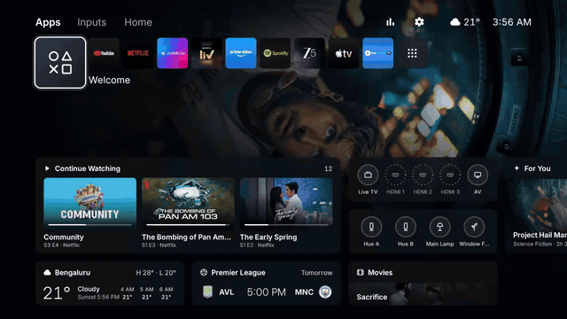
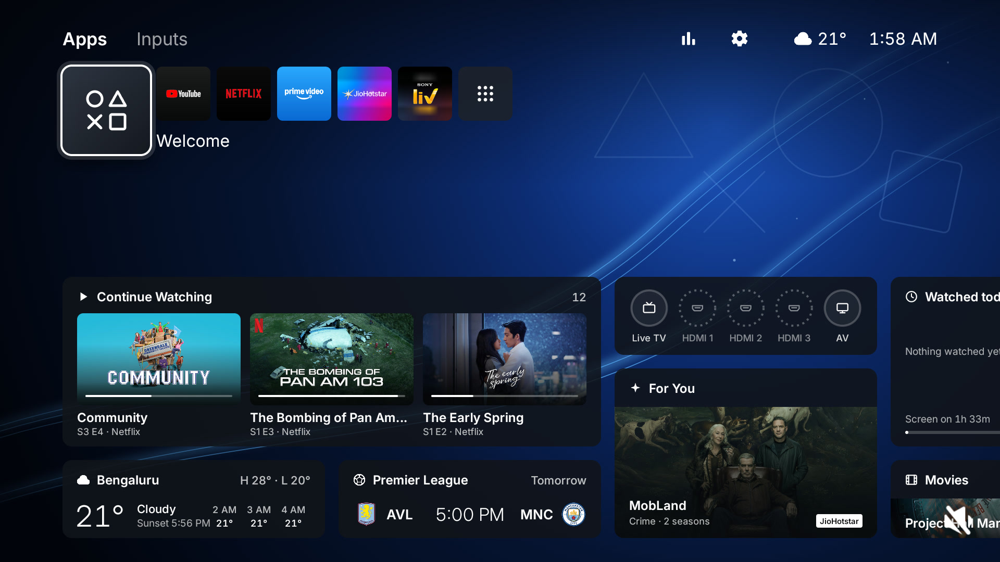
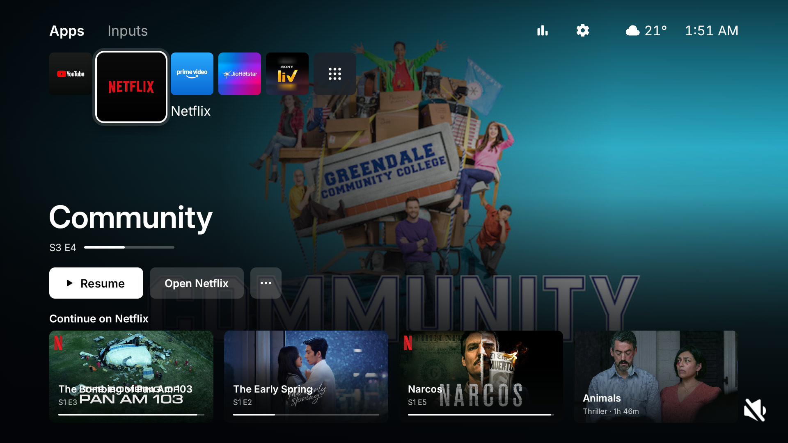
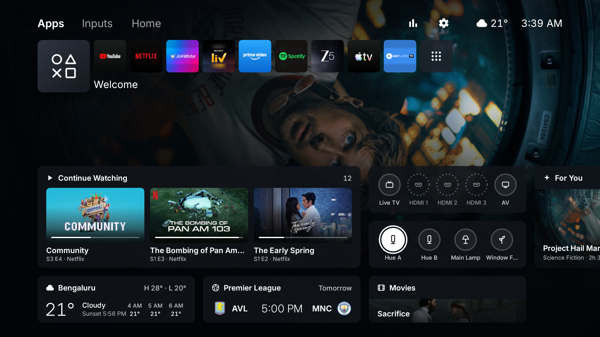
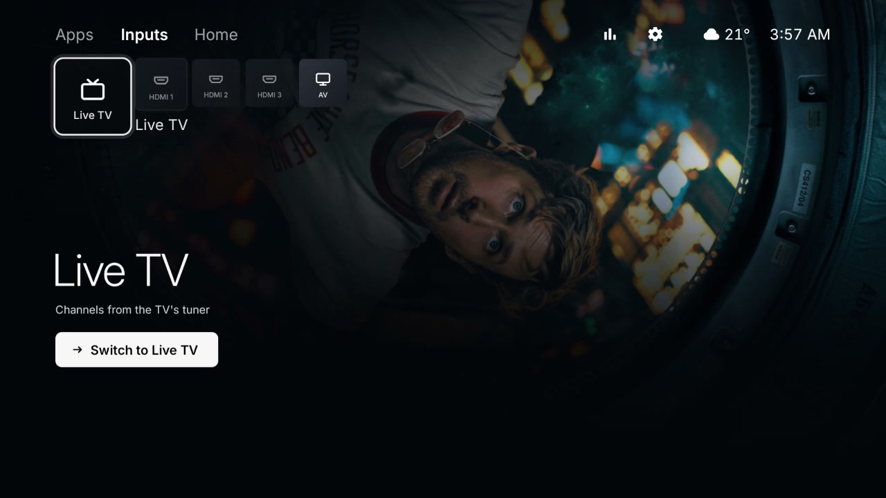
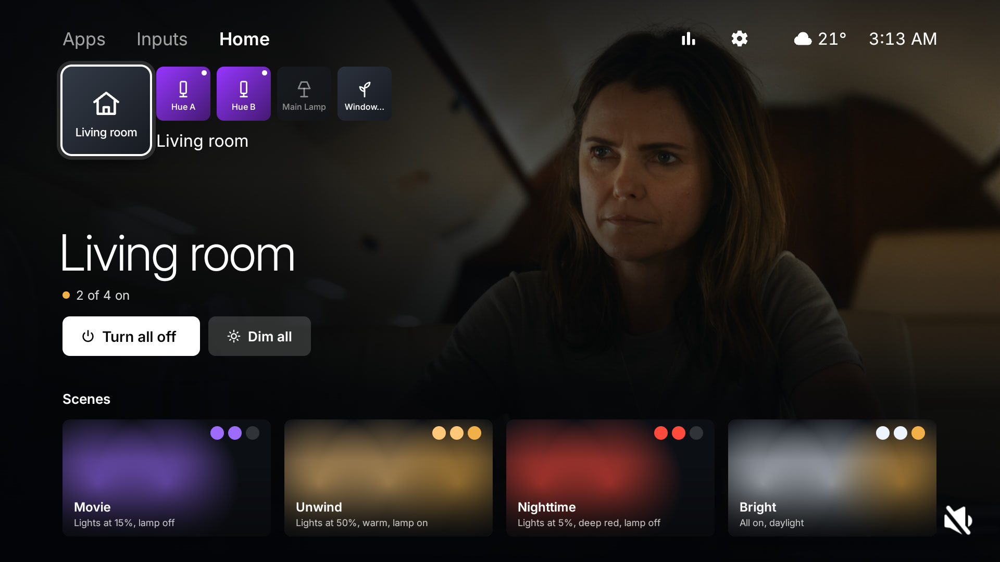
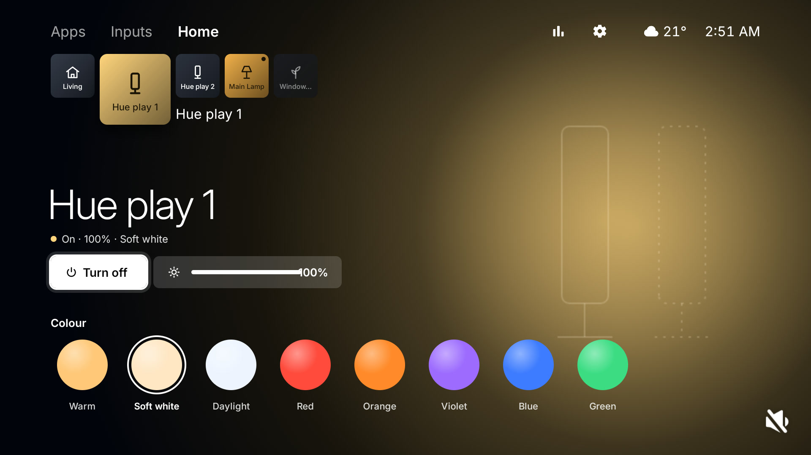
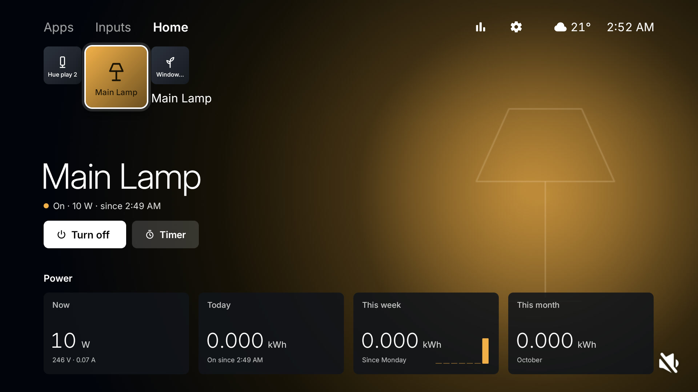
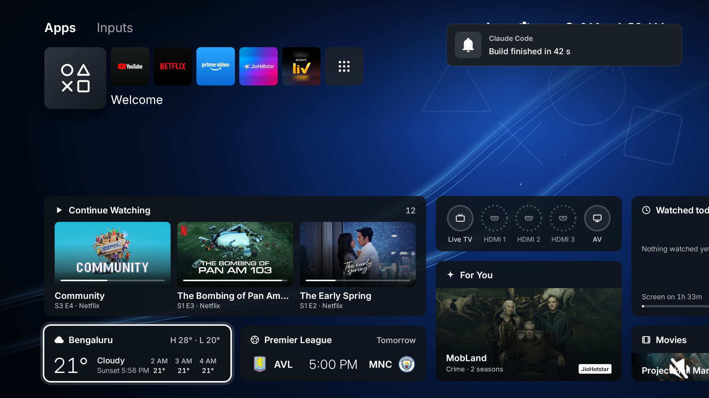
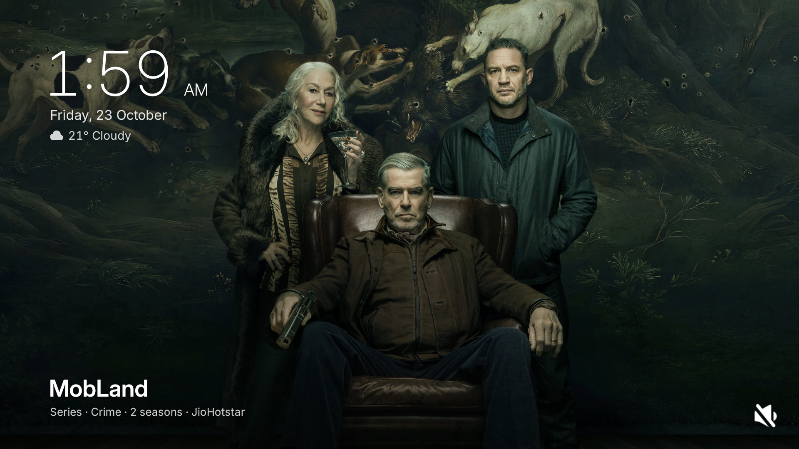

# Argon launcher

The TV's home screen (`com.argon.launcher`), styled after the PlayStation 5's home screen and Welcome hub. One Android
app, Java with no libraries (minSdk 34), that also hosts the [web remote](../remote/README.md)'s server, the viewing
stats, notices over any app, the nature sounds, the screensaver and the room's lights and plugs.

[](docs/media/home_motion.mp4)

▶ **[Watch the motion clip (MP4, 21 s)](docs/media/home_motion.mp4)** · **[The full showcase with sound](../docs/media/argon_showcase.mp4)**

## Screenshots

|                                                                                    |                                                                                   |
| ---------------------------------------------------------------------------------- | --------------------------------------------------------------------------------- |
|                                          |                                                 |
| **Welcome hub:** Continue Watching, inputs, For You, weather, the match, movies    | **App hub:** the show you're partway through, Resume, more of yours and its picks |
|  |                                           |
| **Welcome hub:** the Living room widget, a ring per light and plug                 | **Inputs:** Live TV, HDMI 1–3 (dimmed when nothing is plugged in) and AV          |
|                               |                                          |
| **Home tab:** the room, Turn all off, Dim all and four scenes                      | **A light:** on/off, brightness and eight colours, on a glow of its own colour    |
|                                            |                                      |
| **A plug:** on/off, a timer, and its power now, today, this week and this month    | **Notice:** a card top right over whatever is on screen, posted over adb          |
|                                          |                                                                                   |
| **Screensaver:** the picks' photos with a slow zoom, the clock, date and weather   |                                                                                   |

## Build and install

```bash
tools/build_install.sh
```

From the repo root, with the TV's address in `TV` if it isn't `192.168.2.13:5555`. It builds the release APK, installs
it, compiles it ahead of time, grants what adb can grant (overlay, usage stats, the media listener, TV listings), sets
it as home and screensaver, and disables the stock launcher and setupwraith (see
[Why setupwraith is disabled](../README.md#why-setupwraith-is-disabled)). Needs JDK 17 and the Android SDK
(see [Building on another machine](../README.md#building-on-another-machine)). The web remote's page in
`remote/public` is copied into the APK at build time.

## Source

| Path (`app/src/main/`)               | What                                                                                                                                                                                                                                                                       |
| ------------------------------------ | -------------------------------------------------------------------------------------------------------------------------------------------------------------------------------------------------------------------------------------------------------------------------- |
| `java/com/argon/launcher/`           | The home screen (`HomeActivity`, `HomeView`, `Tiles`, `Glyphs`, `Wallpaper`, `Ambience`…), `Screensaver`, `StatsActivity`, the picks (`Recs`), weather and football, `NoticeReceiver`, `ControlReceiver`, `MediaListener` and the viewing stats (`WatchLog`, `WatchStats`) |
| `java/com/argon/launcher/remote/`    | The web remote's server, in its own `:remote` process: `RemoteService`, `Server`, `Http`, `Auth`, `Adb`, `Mdns` and the Settings, Files, Home screen and stats endpoints (see [the remote docs](../remote/README.md))                                                      |
| `java/com/argon/launcher/smarthome/` | Philips Hue (`Hue`) and Tuya plugs (`Tuya`, `TuyaCloud`), shared through `SmartHome` and `SmartHomeProvider`                                                                                                                                                               |
| `res/values/config.xml`              | The defaults you can change by rebuilding (see [Change the defaults](#change-the-defaults-rebuild))                                                                                                                                                                        |
| `res/raw/ambient_*.ogg`              | The nature loops                                                                                                                                                                                                                                                           |
| `assets/`                            | The Inter font and the Material Symbols icons                                                                                                                                                                                                                              |

## The home screen (on the TV)

Styled after the PlayStation 5's home screen and its Welcome hub, drawn by hand on one Canvas (no Sony artwork: the
glyphs, tiles and wallpaper are drawn here). The [screenshots](#screenshots) show it on the TV.

- **Top:** three tabs, **Apps**, **Inputs** and **Home** (focusing one selects it). Top right: **Your Viewing** (the stats screen),
  **Settings** (the TV's), the weather and the time. While the football club plays, a red **LIVE** pill with the score
  and minute sits left of them.
- **Row:** square tiles, the focused one larger with a white ring and its name beside it. On Apps: **Welcome**, the
  Home apps (YouTube, Netflix, Prime Video, JioHotstar, Sony LIV to start) and **All Apps**. On Inputs: Live TV,
  HDMI 1–3 (the name the device reports over HDMI-CEC, dimmed when nothing is plugged in) and AV. Netflix, YouTube,
  Prime Video and Apple TV tiles are their brand colors with the logo lifted from the app's own TV banner; other apps
  get their banner on a blurred field made from it. On Home: the room, then its lights and plugs (see
  [Lights and plugs](#lights-and-plugs)), each lit in its own colour while it's on.
- **Welcome hub** (below Welcome): widgets on the wallpaper, packed into columns from the left and scrolling sideways
  as the focus moves. **Continue Watching** (the large one shows the last three things you were partway through, from
  Netflix, Prime Video, Hotstar and Apple TV's own rows, with a progress bar; OK resumes it in that app), the
  **weather**, the **match** (crests, kick-off or the score and minute), the **inputs**, the **Living room** (a ring
  per light and plug, filled with its colour while it's on: OK switches it, hold OK opens its page on Home), **For
  You** (this hour's top pick), **Watched today** (opens Your Viewing), and a show and a movie. Widgets with nothing
  to show are left out.
  Which widgets, their order and size, and the wallpaper are set from the web remote's Home screen tab.
- **App hub** (below an app): the show you're partway through in that app as the background (or its top pick), its
  title and progress, **Resume**, **Open** _app_ and **⋯** (Options), then four cards: more of yours, then more picks
  from that app. With nothing to resume, **Open** comes first.
- **Input and All Apps hubs:** the name, its state (connected, nothing plugged in, analog input, the number of apps)
  and **Switch to** _input_ / **Open All Apps**.
- **Home hubs:** the room: how many are on and the watts, **Turn all off** (or on), **Dim all** (lights to 20%) and
  four **Scenes** (Movie, Unwind, Nighttime, Bright). A light: **Turn off**/**on**, its brightness (focus it, then
  Left/Right, 10% a press) and eight colours, on a glow of the light's own colour with a faint outline of it. A plug:
  **Turn off**/**on**, **Timer** (OK steps through off in 30 min, 1 h, 2 h, none) and its power now, today, this week
  and this month, on an amber glow.
- **All Apps:** a library grid of every app, ✓ on the ones already on Home.
- **Options:** **hold OK** on a Home app (or ⋯ in its hub) for **Move** (Left/Right moves it, OK or Back finishes)
  and **Remove from Home**; in All Apps, for **Add to Home** (or Remove) and **Open**. The order is saved on the TV and survives
  restarts and rebuilds. A short message slides in top right to confirm.
- **Wallpaper:** _Waves_ (a deep blue glow with light streaks and faint ○ △ ✕ □ line art, drawn once and kept in
  `files/waves-v2.png`), _Top pick_ (this hour's top pick, darkened), or a photo sent from the web remote
  (`files/wallpaper.jpg`). An app hub cross-fades to that app's picture and back.
- **Screensaver:** the picks' photos full screen, one every 30 s with a slow zoom and pan, the title bottom left, and
  a large thin clock with the date and weather top left (`com.argon.launcher/.Screensaver`, set by
  `tools/build_install.sh`; the system still decides when it starts). With no photos, the Waves wallpaper and a
  drifting clock.
- **Motion, PS5-style:** quick and without overshoot. Along the row the focused tile grows in place while the row
  glides under it; the old name fades in the first half of the move and the new one slides out from its tile in the
  last. Moving starts the hub fading out at once; the new hub rises in once the row stops (~150–300 ms), and the new
  picture fades in over the old one just after, settling from a slight zoom. In a hub the focused button, card or
  widget lifts (grows 4–5 %) and gets its ring; OK presses the focused thing in while held. A new tab's row slides in
  from the right tile by tile, and so does the row whenever you come back home. Options scale in from their item; a
  message slides in from the right.
- A quiet click plays on focus moves and opens (home screen only).

Data: TMDB (picks), Open-Meteo (weather, sunrise, sunset; no key), ESPN's public scores feed (the match; no key). The
match refreshes every 30 s during a game, otherwise every 30 minutes and again at kick-off; the weather every 30
minutes; the picks every 6 hours or when the time of day changes. All only while the home screen (or screensaver) is
showing.

### The TMDB key

Free: make an account at [themoviedb.org](https://www.themoviedb.org/signup), then Settings → API → request a developer
key. Put the _API Read Access Token_ (or the _API Key_) in `launcher/secrets.properties`:

```properties
tmdb_key=eyJ...
tmdb_region=IN
```

The file is gitignored and the key is built into the APK (`BuildConfig.TMDB_KEY`); it never goes to the log. Without
it everything works except the picks and the screensaver photos (For You, the show and movie widgets and the app hubs'
cards are left out; Continue Watching still works). `tmdb_region` decides which app streams what.

## Using the TV remote

- **Row:** Left/Right between tiles (the hub below follows the focus), **Up** to the tabs, **Down** into the hub.
- **Tabs and buttons:** one line: Left/Right across Apps, Inputs, Home (focusing a tab selects it), Your Viewing and
  Settings. **Down** returns to the row.
- **Hub:** the arrows move between widgets, buttons and cards by where they sit on screen; **Up** from the top of the
  hub returns to the row. OK on **Welcome** (or the room) also goes into its hub; OK on a light or plug switches it.
  On a light's brightness bar, Left/Right change it instead of moving.
- **All Apps:** the arrows move across the grid; **Back** closes it.
- **OK** opens on release; **hold OK** for Options (Move / Remove on a Home app, Add to Home in All Apps).
- **Back** steps out: Options, Move, All Apps, the hub, then to the first tile. **Home** while already home goes back
  to Welcome on Apps with everything closed. A game controller's A works as OK.

## Change the defaults (rebuild)

Edit `launcher/app/src/main/res/values/config.xml`, then run `tools/build_install.sh`.

- **Starting Home row:** `dock_packages` (left to right, any number). Changing this list resets the row on the TV to
  it; rebuilding without changing it keeps your on-TV edits. Find a package name with
  `adb -s 192.168.2.13:5555 shell pm list packages | grep -i <name>`.
- **Brand tiles:** `BRANDS` in `Apps.java` (package → tile colors, logo color, how to lift the logo from the banner,
  size tweak). The lifted logos are cached in the app's cache dir and redone when the app updates.
- **Welcome hub widgets:** `DEFAULT_WIDGETS` in `Config.java`, `id:S|L` in order (`continue`, `weather`, `match`,
  `inputs`, `foryou`, `watch`, `shows`, `movies`; `L` is two units tall, and a large Continue Watching two columns
  wide). Used until the web remote sets the list; a widget left out is off.
- **Wallpaper:** `waves` (default), `pick` or `photo:<stamp>` (set by the remote's upload), in `Config.wallpaper`.
  To redraw Waves after changing `Wallpaper.java`, raise its `VERSION`.
- **Picks:** `SERVICES` in `Recs.java` maps TMDB's service names to the apps on the TV; the key and country are in
  `launcher/secrets.properties`.
- **Live TV app** on the Inputs tab: `live_tv_package`.
- **Football team:** `football_team` is the ESPN team id, the number in the club's espn.com address (Man City `382`,
  e.g. `espn.com/soccer/club/_/id/382/manchester-city`). Empty hides the LIVE pill and the match widget.
- **Custom tile art:** a 320×180 image at `res/drawable-nodpi/banner_<package with dots as underscores>.png` replaces
  that app's own banner (its tile and All Apps). `banner_com_sonyliv.png` is one: Sony LIV only ships a small square icon on black, so this is
  composed from the app's own "SONY" and "liv" logo artwork.

## Nature sounds

A quiet nature loop plays while the home screen is on screen, picked by time of day: morning birdsong (5–12),
afternoon wind in trees (12–17), evening ocean waves (17–22), night crickets and frogs. Rules, in order of priority:

- it plays only while home is visible and focused and the screen is on; it waits 1.5 s, then fades in over 4 s;
- launching anything (an app, Settings, an input) fades it out in 150 ms before the app opens; the decoders are
  released while you're away, so apps get the memory back;
- it never starts, and fades out, while any other app is playing (Spotify, a voice reply, anything except notification
  and click sounds), and it waits for audio focus. Assistant pauses it and it resumes afterwards; if another app takes
  focus for good, it stays quiet until that app stops playing or you leave and come back home;
- the screensaver and standby stop it (home isn't visible then).

Setting in `config.xml` (or the web remote): `ambient_volume` (percentage of the TV volume, default 35; `0` turns
sounds off). The loops are `launcher/app/src/main/res/raw/ambient_{morning,afternoon,evening,night}.ogg`;
to swap one, cut a new loop and rebuild, e.g.
`python3 tools/make_loop.py waves.ogg launcher/app/src/main/res/raw/ambient_evening.ogg 60 120` (start and length in
seconds; optional 5th argument is the high-pass cut-off in Hz, default 60).

Recordings, all from Wikimedia Commons:

| Loop      | Recording (section used)                                                                                                                       | Author           | Licence      |
| --------- | ---------------------------------------------------------------------------------------------------------------------------------------------- | ---------------- | ------------ |
| Morning   | [Birdsong morning 01](https://commons.wikimedia.org/wiki/File:Birdsong_morning_01.ogg) (1:50–4:20)                                             | Matutinho        | CC BY-SA 4.0 |
| Afternoon | [Wind sounds 2020-05-10 1625](https://commons.wikimedia.org/wiki/File:Wind_sounds_2020-05-10_1625.mp3) (5:40–7:40)                             | Robert EA Harvey | CC BY-SA 4.0 |
| Evening   | [Ocean Waves on a Tropical Beach](https://commons.wikimedia.org/wiki/File:Ocean_Waves_on_a_Tropical_Beach.ogg) (1:00–3:00)                     | J.D. Savanyu     | CC0          |
| Night     | [Nature sounds ambience in a Dordogne pond](https://commons.wikimedia.org/wiki/File:Nature_sounds_ambience_in_a_Dordogne_pond.ogg) (0:00–0:52) | Glaneur de sons  | CC BY 3.0    |

Each was high-passed, cross-faded into a 4 s seamless loop and matched to −26 LUFS.

## Notices over any app

The launcher can show a card in the top-right corner over anything on screen, including Netflix, YouTube and HDMI inputs.
It slides in, stays for a few seconds and slides out. It never takes focus, so the remote keeps controlling the app
underneath. A new notice replaces the one on screen and restarts its timer.

```bash
tools/notice.sh -t "Claude Code" "Build finished in 42 s"
tools/notice.sh -s 20 "Line one\nLine two"
```

- `-t` is a small label above the text (optional); `-s` is how many seconds it stays (default 8, at most 600).
  `\n` starts a new line; the text is cut off after 6 lines.
- Without the script: `adb shell am broadcast -a com.argon.launcher.NOTICE -p com.argon.launcher --es text '…' [--es title '…'] [--ei seconds 8]`.
- Only adb (the shell user) can post notices: the receiver requires the `DUMP` permission, which apps can't get.
- Drawing over other apps needs the overlay permission. Android TV has no settings screen for it, so
  `tools/build_install.sh` grants it with `appops set com.argon.launcher SYSTEM_ALERT_WINDOW allow`. If notices stop
  appearing, run that again; `adb logcat -s Notice` says when it's missing.
- Nothing shows while the TV is in standby. Wake it first with `adb shell input keyevent KEYCODE_WAKEUP`.

## Viewing stats

The launcher keeps a record of what the TV shows and turns it into stats for today and this week (from Monday):

- **On the home screen:** a _Watched today_ widget on the Welcome hub (the total, the top three apps with their time,
  and how much of the screen-on time was watching). It, or the **Your Viewing** button (top right), opens the full screen: headline numbers, a chart by hour or by day (**Left/Right** switch Today and This
  week), shows and videos, and an apps table with time today, this week and how many times each opened.
- **On the remote:** the **Watching** tab, and a _Watching today_ card under Input on the laptop layout.
- **As JSON:** `adb shell content read --uri content://com.argon.launcher.stats/stats.json` (shell only, like the
  notice receiver). The remote's `GET /api/watch` is this call.

Where the numbers come from:

| What                                 | Source                                                                                                                                                                                          |
| ------------------------------------ | ----------------------------------------------------------------------------------------------------------------------------------------------------------------------------------------------- |
| Time per app, opens, screen on/off   | The system's usage events (`UsageStatsManager`), read in batches whenever stats are shown. Needs `appops set … GET_USAGE_STATS allow`.                                                          |
| What's playing, with titles          | Media sessions, through `MediaListener` (a notification listener used only for that). Needs `cmd notification allow_listener`. YouTube, JioHotstar and Sony LIV name the video; others may not. |
| Netflix, Prime Video, Apple TV shows | The Continue watching rows those apps publish: title, episode and how far in. `MediaListener` keeps a snapshot each time an app changes them.                                                   |

**Time per show for apps that don't name what's playing.** Netflix plays with no title at all and Prime Video gives
its own name. Their untitled time (untitled plays, or time in the app where no play was recorded) is split between
the titles the app touched in Continue watching: an app updates a row when you stop or move on, so time up to each
update goes to that title, and what's left goes to the next update within 30 minutes or the last one. Time with no
update nearby shows as _Other on Netflix_. Updates are only kept from 23 Oct 2026 on (the TV keeps just the latest
one per title), so earlier Netflix time is mostly _Other_.

`tools/build_install.sh` grants both permissions. Home screens, Settings, system screens and the screensaver count as
screen time but not as watching (the list is `NOT_WATCHING` in `WatchStats.java`). HDMI inputs and Live TV count as
the Live TV app; what's on the HDMI device isn't known.

**Storage.** Everything stays on the TV, in the launcher's private database `/data/data/com.argon.launcher/databases/watch.db`
(tables `app` and `screen` for spans, `play` for what played, `watchnext` for Continue watching snapshots, `state` for
where reading left off), a few MB a year. The
system keeps only about a week of usage events, so the first run copies what's still there; after that the launcher's
copy is the record. It survives rebuilds (`install -r` keeps app data) but not an uninstall or factory reset. To keep
a copy on the Mac:

```bash
adb exec-out content read --uri content://com.argon.launcher.files/watch.db > watch.db
```

To put it back after a reinstall, before the launcher opens it (refused once it has):

```bash
adb shell am force-stop com.argon.launcher
adb shell content write --uri content://com.argon.launcher.files/watch.db < watch.db
```

## Lights and plugs

The room's Philips Hue lights and Tuya Wi-Fi plugs (Wipro and most Indian brands), controlled straight over the LAN:
no Google cloud, no hub besides the Hue Bridge, and they keep working without the internet. Google Home, the Hue app
and the plugs' own buttons still work alongside; whatever changes them shows on the TV and every open remote at once.

|            | How                                                                                                                                                        | Measured                                                          |
| ---------- | ---------------------------------------------------------------------------------------------------------------------------------------------------------- | ----------------------------------------------------------------- |
| Hue lights | The bridge's local API (CLIP v2 over HTTPS, its certificate pinned when pairing); its event stream brings every change                                     | ~150 ms a command, ~200 ms for a change to come back              |
| Tuya plugs | Tuya's local protocol 3.3 (AES-128 frames on TCP 6668) with each plug's local key; one connection kept open with a heartbeat, so the plug pushes its state | ~90 ms a command; a change made in Google Home arrives in ~200 ms |

**Where it runs.** `smarthome/SmartHome` lives in the web remote's process (`:remote`, always running), with one
connection to the bridge and one to each plug. The remote's server uses it directly and pushes `{"t": "home"}` to
every page on each change; the home screen (main process) reads it through `SmartHomeProvider` (not exported) and
re-reads whenever it announces a change. A Tuya plug takes only a few local connections, so only this one process
connects; a phone with the Smart Life app open can briefly take the slot, and the TV retries (1 s, doubling to 30 s).
The plugs' addresses come from the announcements every Tuya device broadcasts on UDP 6667, so a new DHCP address is
picked up by itself; the bridge is found again over multicast DNS (`_hue._tcp`).

**Setting up** (web remote › Home screen › Lights and plugs):

1. **Hue Bridge:** **Pair**, then press the round button on top of the bridge within a minute (the TV shows a notice).
2. **Plugs:** they need to be in the **Smart Life** (or Tuya) app, not their brand's app. At
   [platform.tuya.com](https://platform.tuya.com) make a cloud project (Smart Home, the data centre your app account
   is in), then **Devices › Link App Account** and scan the QR code from Smart Life (Me › scan icon). Copy the
   project's **Access ID** and **Access Secret** into **Add plugs**: the TV fetches each plug's local key once and keeps
   only those. A plug that's reset and added again gets a new key: **Fetch keys again**.
3. Name each one and pick its icon (light bar, bulb, lamp, plant, plug) in the same card. Plugs with the lamp icon are
   the ones the scenes switch.

Data: `files/smarthome.json` (the bridge's address, key and pinned certificate, the plugs' ids, keys and addresses,
names, icons, order) and `files/smarthome_energy.json` (each plug's kWh per day, the last 40 days, added up from the
power it reports). To keep a copy of the keys, or put one back into a fresh install (then force-stop the launcher):

```bash
adb exec-out content read --uri content://com.argon.launcher.files/smarthome.json > smarthome.json
adb shell content write --uri content://com.argon.launcher.files/smarthome.json < smarthome.json
```

Logs: `adb logcat -s SmartHome`.

## Resource use

Launcher: ~62 MB PSS on the home screen (the glass home before it was ~120 MB): pictures are kept at 1280×720 in GPU
memory, with a 640×360 copy for cards, at most ~14 picks and 10 Continue Watching images, and tiles, shadows and the
wallpaper are built once and kept as textures. The web remote's `:remote` process adds ~15 MB PSS (~30 MB while a page shows the TV picture); as a foreground
service it isn't killed while apps play.

What matters on this TV is not redrawing while something moves (measured on the TV with `dumpsys gfxinfo` framestats
and `atrace` while driving it over adb). Moving, scaling or fading what's already drawn keeps up with the screen;
redrawing a hub or the row on every frame of a move is what dropped frames. So the home screen is built from views
that are drawn once and then only moved: every row tile, its ring, its shadow and its name are separate views the row
slides, scales and fades; each hub is drawn into a hardware layer (two screen-wide ones that take turns, and a wide
one for the Welcome hub, which scrolls by moving it) once the row stops, while the old one has already faded; a
focused button, card or widget gets a small overlay with its focused look (ring, white fill, lift) that fades and
grows, so the hub underneath is never redrawn for a focus move; the background is two picture views that cross-fade
by opacity; the toast and Options move the same way. Pictures in cards come from a 640×360 copy instead of the
1280×720 one, layers move by whole pixels, and the row's springs stop once they're a fraction of a pixel away.

Result, counting the screen refreshes that got no new frame during the animations: moving along the row and switching
tabs 59–60 fps (1% missed, the frame that draws a new hub), focus moves in the hubs, scrolling the Welcome hub and
background changes 60 fps (none missed); over a mixed session of ~2,300 frames 1.4% janky, GPU median 6 ms. Frames
often finish 20–35 ms after their refresh while the screen buffers are all in use: that's two frames of delay, not
dropped frames. Before this, the row didn't animate at all (a bug snapped it) and every focus move in a hub redrew
it.

Right after `tools/build_install.sh` the system sometimes can't find the contiguous memory (CMA) for the launcher's
window and home stays black (`GraphicBufferAllocator: Failed to allocate (1920 x 1080)`); the script restarts the
launcher once more for that. Apps left running in the background (TV Settings, a streaming app) hold a lot of it:
`adb shell grep CmaFree /proc/meminfo`.

No frames are drawn while nothing moves. The nature loop costs ~4% of total CPU (decoder + audio server) while it plays
and nothing when home is in the background. Free RAM after debloat: ~590 MB vs ~540 MB before, with ~15 fewer background processes.
