# Argon web remote

A remote for the TV that runs in any browser on the same Wi-Fi: phone, tablet or laptop. The TV serves it itself at
**`http://argon.local:7777`**; nothing runs on a computer. Keys, a touch surface, typing into the TV, the TV picture,
Continue on TV, the room's lights and plugs, the TV's settings, its files, viewing stats and the device's health.

| Laptop                                                                                      | Phone                                                                                   |
| ------------------------------------------------------------------------------------------- | --------------------------------------------------------------------------------------- |
| [](docs/media/remote_laptop.mp4)         | [](docs/media/remote_phone.mp4)        |
| ▶ [MP4, 27 s](docs/media/remote_laptop.mp4): keys, a light, its colour, then the other tabs | ▶ [MP4, 13 s](docs/media/remote_phone.mp4): swipes, tap for OK, a plug, a light's sheet |

The page's code is in [`public/`](public/); its server is part of the launcher, in
[`launcher/app/src/main/java/com/argon/launcher/remote/`](../launcher/app/src/main/java/com/argon/launcher/remote/).

## Screenshots

**Laptop** (mouse and keyboard):

|                                                                                       |                                                                            |
| ------------------------------------------------------------------------------------- | -------------------------------------------------------------------------- |
|                  | 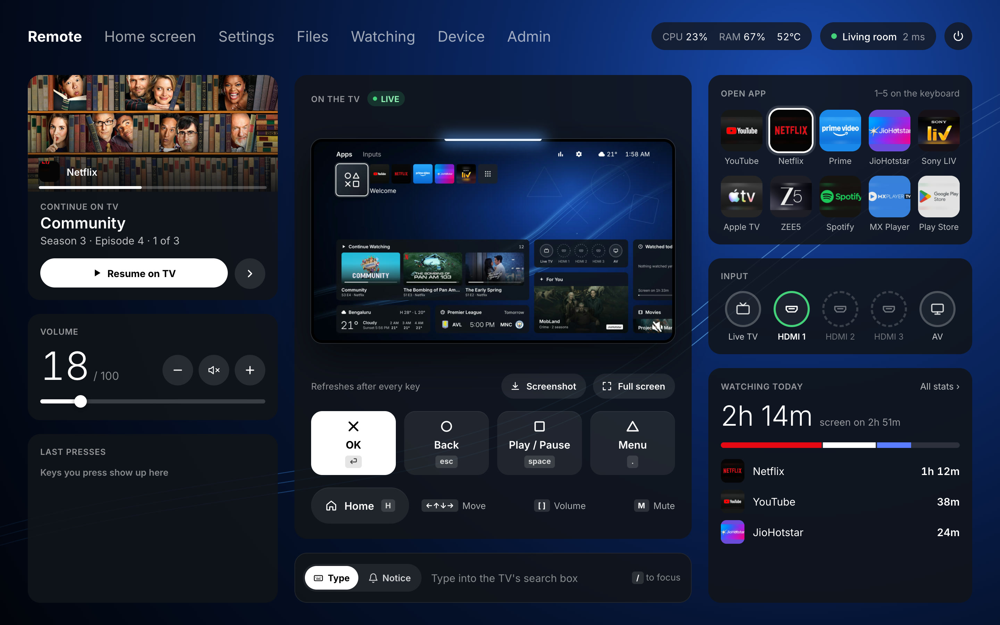        |
| **Remote:** Continue on TV, volume, the room, the keys, apps, inputs, Watching today  | **Remote** without lights: the TV picture, live, refreshed after every key |
| 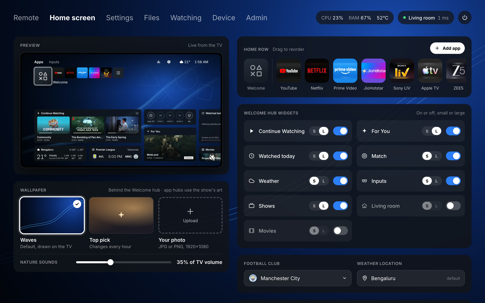                                 | 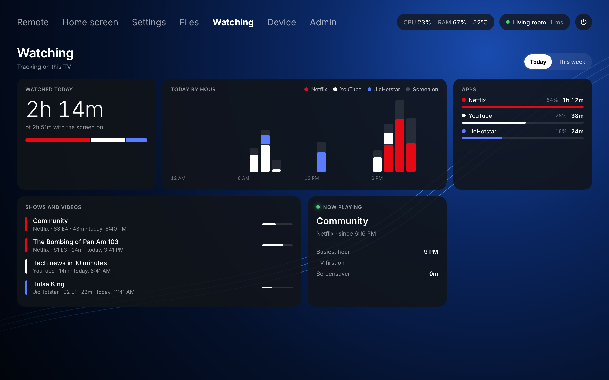                            |
| **Home screen:** edits the launcher live: Home row, widgets, wallpaper, club, weather | **Watching:** today or this week, by hour or day, apps and shows           |
| 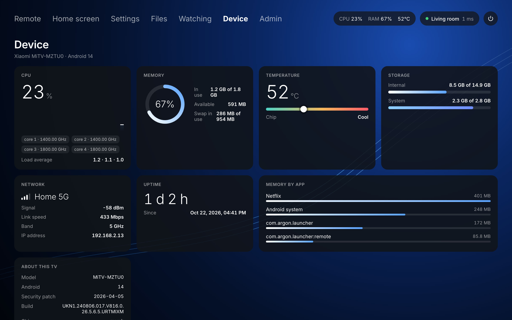                                           | 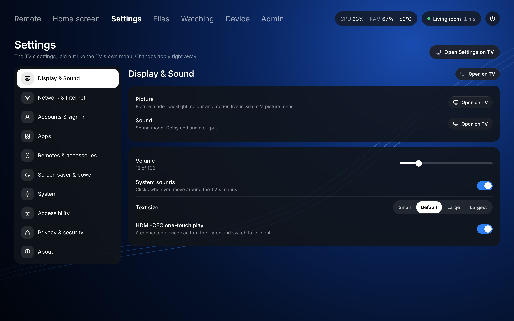                            |
| **Device:** CPU, memory, temperature, storage, Wi-Fi, top apps, build                 | **Settings:** the TV's menu; what adb can change is changed here           |
| 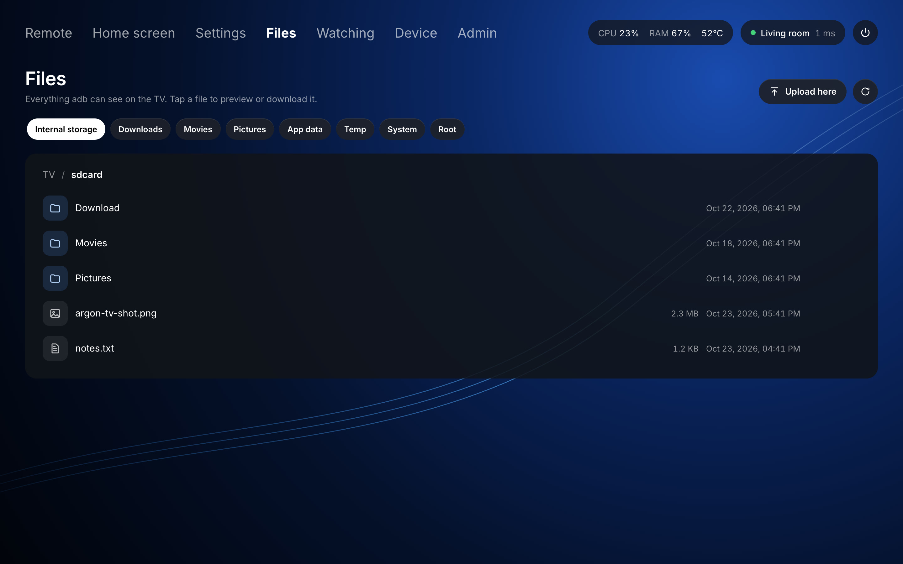                                             | 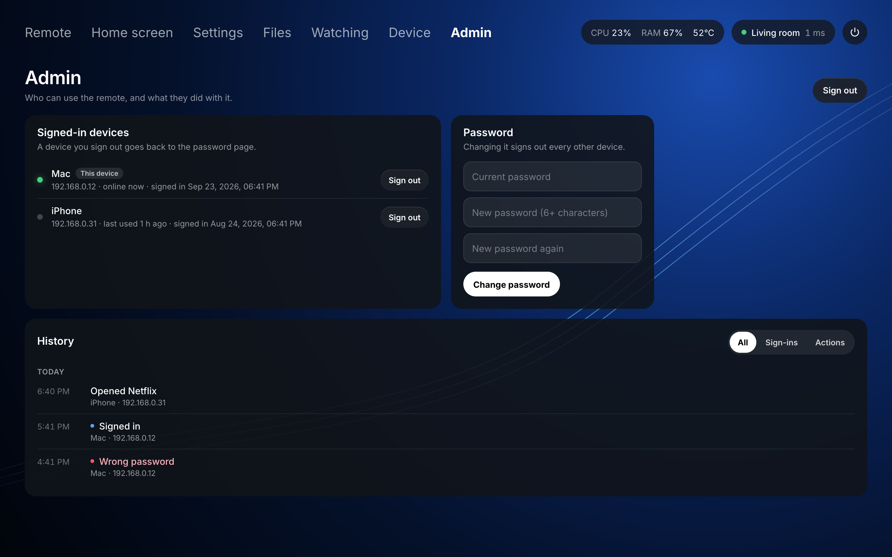                                  |
| **Files:** browse, preview, upload, download and delete                               | **Admin:** signed-in devices, the password and the history                 |

**Tablet and phone** (touch):

| Tablet                                         | Phone                                        | A light's sheet                                               |
| ---------------------------------------------- | -------------------------------------------- | ------------------------------------------------------------- |
| 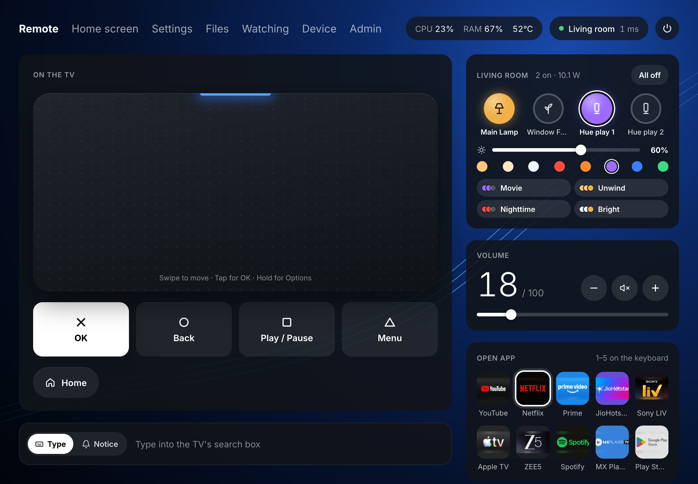 | 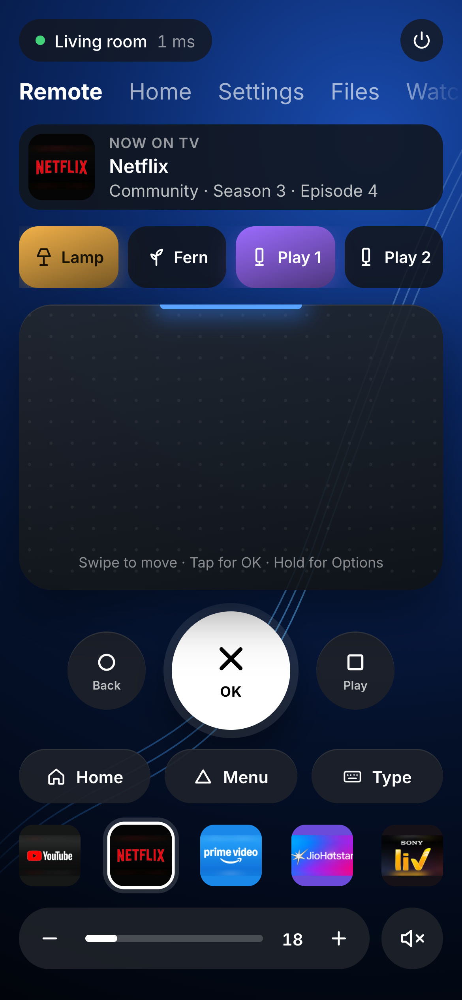 | 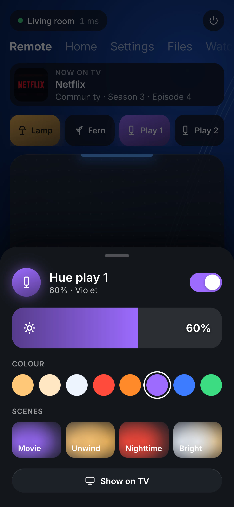 |

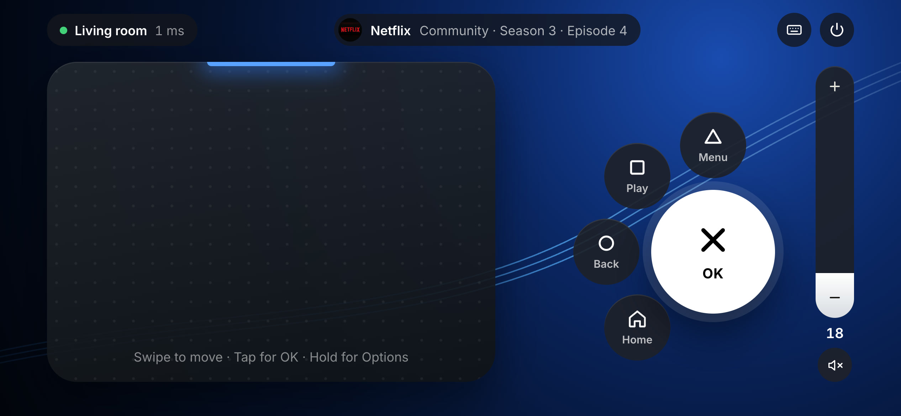

**Couch mode:** a phone held sideways, the touch surface on the left and the buttons in a fan for the right thumb.

The screenshots and clips were taken from the page in `public/` against a local stand-in for the TV's API, with a
frame from the TV as its picture; the numbers and names in them are examples.

## Changing the page

Edit `public/`, then rebuild and install the launcher from the repo root:

```bash
tools/build_install.sh
```

The page ships inside the APK (`assets/remote`, copied by the `copyRemoteAssets` task in `launcher/app/build.gradle`),
so a change shows up after the install. The motion is the "Motion" block at the end of `public/app.css`.

## How it works

The TV serves it itself: open **`http://argon.local:7777`** on a phone, tablet or laptop on the same Wi-Fi (or
`http://<tv-ip>:7777`). On a phone, use Share › Add to Home Screen so it opens full screen like an app. Nothing has to
run on a computer.

**How it runs.** `RemoteService` (`launcher/…/remote/`) is a foreground service in its own `:remote` process.
`HomeActivity` starts it, so it's up whenever the TV is, and it keeps running while an app plays even if the home
screen is closed. `remote/public` is copied into the APK (`assets/remote`) at build time, so a page change needs
`tools/build_install.sh`. Nearly everything the page does needs the shell user (keys, `am`, `settings`, files), so the
service talks to the TV's own adbd on `127.0.0.1:5555` (network debugging is on) with a small adb client (`Adb.java`)
and its own RSA key, kept in the launcher's private storage. The first time, and after an uninstall, the TV asks
**Allow USB debugging?**: tick **Always allow from this computer** and press **Allow**. If something covers the
prompt (the home screen after an install does), a new one appears within a minute. If adbd goes away, every shell
waits on one shared reconnect loop (1 s, doubling to 15 s). `argon.local` comes from the service's own multicast DNS
responder (`Mdns.java`), so it follows the TV when the router gives it a new address. Logs: `adb logcat -s Remote`.

Neither the router nor a Mac is a good host: the router (D-Link DIR-825ACG1: Realtek Lexra chip, 64 MB RAM, stock
firmware) can't run it, and a Mac only serves it while it's awake and on this Wi-Fi.

**Password.** Every page, API call and the live connection need a sign-in. The first time, the page asks for a
6-digit code that the TV shows as a notice (valid 5 minutes, five tries) and then the password (at least 6
characters), so only someone in the room can set it. **Forgot the password?** on the sign-in page does the same and
signs every device out. Each phone, tablet or laptop then signs in once and stays signed in until it goes 180 days
without opening the remote. The password is kept only as a PBKDF2-SHA256 hash (200,000 rounds) in the launcher's
private storage (`files/remote/auth.json`); each device gets a random `HttpOnly` cookie, of which the server keeps
only a SHA-256. Five wrong passwords or codes from one address lock it out for 30 s, doubling on each further miss up
to 15 min.

The page has the TV's look (navy, the ✕ ○ □ △ glyphs, a blue light bar) and picks its layout from the screen: a phone
(under 700 px wide, or a touch screen with a phone-sized short side) gets the touch surface with a big ✕ OK, ○ Back
and □ Play, Home / △ Menu / Type, the Home apps and the volume; a phone held sideways gets **couch mode**, the touch
surface on the left and the buttons in a fan for the right thumb, with a volume rail you drag; a wider touch screen
gets the tablet layout; a mouse and keyboard get the laptop layout. `?mode=phone|tablet|laptop` forces one.

- **Touch surface:** each ~40 px of drag is one step; a quick flick adds up to 5 more; tap is OK; hold is a long OK
  (the launcher's Options). A chip in its corner shows what the TV confirmed (`→ ×3`, and the round trip on a laptop).
- **Light bar:** blue while connected, a white flash on each key the TV confirms, orange while muted, red when the TV
  can't be reached.
- **Motion, as on the TV** (the "Motion" block at the end of `app.css`): quick and without overshoot. Under a mouse
  or keyboard focus, app tiles, input rings, buttons and keys lift toward you (tiles with the white ring); anything
  pressed dips. Opening the Remote tab brings its cards in down each column, the columns left to right; any other
  tab's cards rise in one after another (on the phone they slide in from the side you moved toward). That plays only
  for 1.6 s after you open a tab, so pages that redraw later (Home on every change, Device every 2 s) don't replay it.
  Continue on TV's next picture fades in over the last and settles from a slight zoom; the TV picture cross-fades
  between frames; the app on the TV, a new key in Last presses and dialogs pop in; on a laptop, messages slide in at
  the top right. Off when the system asks for reduced motion.
- **Buttons and keys** send key-down on press and key-up on release, so holding one repeats on the TV like the real
  remote.
- **Keyboard:** arrows move, Enter = OK, Esc or Backspace = Back, H = Home, Space = play/pause, `[` `]` = volume,
  M = mute, `.` = menu, the number keys open the first Open app tiles, `/` types into the TV's focused text field (Enter searches).
- **Game controller** (any the browser sees as a standard gamepad, e.g. a DualSense over Bluetooth): ✕ OK, ○ Back,
  □ play/pause, △ menu, the D-pad or left stick move, L1/R1 rewind and fast-forward, L2/R2 volume, PS Home, the
  touchpad click OK, Options the hold-OK menu, Create opens the type bar. A chip shows when one is connected.
- **Typing and notices:** when a text box on the TV brings up the on-screen keyboard (the server checks `mInputShown`
  in its status poll), the type bar opens by itself: on a laptop the keys go straight to the TV, on a phone or tablet
  one tap on the bar brings up its keyboard. It closes again when the TV keyboard does. Apps that draw their own
  keyboard don't trigger it; use `/` or the keyboard button there. Switch the bar to **Notice** to send a message
  instead: it shows on the TV as a notice card titled "From _device_" over whatever is playing (500 characters at
  most, 12 s).
- **The TV picture** (laptop, and the Home screen tab's preview): what's on screen, refreshed half a second after each
  key and every 5 s while it's in view. **Screenshot** saves the full-size PNG; **Full screen** enlarges it. While
  Netflix or other protected video plays, the TV refuses the capture, so the page says the picture is hidden. The server
  reads `screencap`'s raw pixels and makes a 960×540 JPEG (~0.2 s of the TV's CPU; the PNG costs ~2.3 s, so only
  Screenshot asks for it), and pages asking within 400 ms share one capture.
- **Continue on TV** (laptop): what you were watching, from the same rows as the home screen's Continue Watching,
  with the picture, episode and progress; **Resume on TV** opens it in its app and the arrow steps to the next one.
- **Watching today** (laptop): the total, the split between apps and the top apps.
- **Lights and plugs:** on a phone, a row of buttons under Now on TV; on a tablet, a card at the top of the side
  column; on a laptop, the middle of the page, in place of the TV picture (which is left out once there are lights):
  a tile per light and plug, the picked one's brightness and colours or power and timer, and the scenes, with the
  OK / Back / Play / Menu keys under it. Tap one to switch it (on a tablet, tapping its name, on a laptop anywhere
  but its ring, picks it for the controls); **hold** for its sheet: brightness, colours and scenes for a light, power
  and a timer (while it's on) for a plug, and **Show on TV**, which opens its page on the Home tab.
- App tiles start the app directly (`am start`), inputs switch through the TV input framework (an HDMI port with
  nothing switched on is dimmed; the server asks `TvInputManager` and pushes a change as it happens), the volume
  slider sets the media volume, and "Now on TV" polls the foreground app every 4 s (paused while keys are being
  pressed). **Last presses** on the laptop lists the recent keys.

**Why it's fast.** `adb shell input keyevent` costs ~140 ms per press (a new adb session plus `cmd input`). The server
instead keeps one `uinput -` stream open on its adb connection: the TV's own `uinput` tool registers a virtual remote
("Argon Remote") and each key is one JSON line on its stdin. Writing to the real remote's `/dev/input/event*` with
`sendevent` is refused by SELinux. The status pill shows the whole path (browser → TV and back); the adb leg is timed
with an `echo` on its own shell every 2 s and is 1–2 ms over loopback.

The volume pops up in the middle of the page whenever it or mute changes (from the page, the real remote or an app),
and the laptop layout has a volume panel under Continue on TV.

The first Open app tiles are `APPS` at the top of `Server.java`; their tile colours are in `APP_STYLE` in
`remote/public/app.js`.

A red banner across the top means the page can't reach the TV, or the remote can't reach the TV's adbd; it clears by
itself once the connection is back.

### The other tabs

- **Home screen** edits the launcher live: the TV picture as a preview; the **wallpaper** (Waves, this hour's top
  pick, or upload a JPG or PNG, which the TV crops to 1920×1080); the nature-sounds volume; the **Home row** (drag
  into order, add or remove apps); the **Welcome hub widgets** (each on or off, small or large; one at least stays
  on); the **football club** (searched across 15 ESPN leagues) and the **weather location** (Open-Meteo, no key;
  empty = Bengaluru); **Lights and plugs**: pairing the Hue Bridge, the plugs' keys, and each one's name and icon (see
  [Lights and plugs](../launcher/README.md#lights-and-plugs)).
- **Settings** follows the TV's own menu (Display & Sound, Network, Apps, Remotes, Screen saver & power, System,
  Accessibility, About). What adb can change is changed from the page: system sounds, text size, HDMI-CEC one-touch
  play, screen saver and its timings, automatic time and 24-hour clock, animation speed, high-contrast text, captions,
  and per-app Force stop / Clear cache / Turn off / Turn on. Everything else (Xiaomi's picture and sound menus,
  accounts, Wi-Fi, language) has an **Open on TV** button that jumps the TV straight to that screen. Restart asks first.
- **Files** browses the TV as the adb shell user sees it (`/sdcard`, `/system`, `/data/local/tmp`…; `/data` itself is
  off limits): preview images, video, audio and text, download anything, upload into the open folder, delete (asks
  first; there's no undo).
- **Watching** shows today or this week from the launcher's viewing stats (see [Viewing stats](../launcher/README.md#viewing-stats)):
  totals, a chart by hour or day, apps, shows and videos, and what's playing now. It refreshes every 30 s.
- **Device** refreshes every 2 s: CPU use with a history graph and core clocks, memory and swap, chip temperature
  (from `dumpsys thermalservice`; the thermal zones aren't readable), storage, Wi-Fi signal and speed, uptime, the apps
  using the most memory, and the build details. The laptop and tablet remote show CPU, RAM and temperature in the header.
- **Admin** lists the signed-in devices (name, address, online now or last used, when they signed in) with a Sign out
  button for each, changes the password (which signs out every other device), and shows the history: sign-ins, wrong
  passwords and sign-outs, plus what each device did — apps opened, inputs switched, power, text typed on the TV,
  settings and home-screen changes, app actions, and files uploaded, downloaded or deleted. Single key
  presses and the volume aren't logged. The history is `files/remote/history.jsonl` in the launcher's private storage
  (the last 2,000 entries are kept; the page shows the latest 500) and refreshes every 5 s.

**How the page changes the launcher.** `ControlReceiver` in the launcher takes
`am broadcast -a com.argon.launcher.CONTROL -p com.argon.launcher --es cmd state|set|banner …` (shell only, like
the notice receiver) and answers in the broadcast's result data. A `set` writes the launcher's prefs; `HomeActivity`
listens for pref changes and applies them on screen at once. The keys and their `config.xml` fallbacks are in
`Config.java`. The launcher must be the build from this repo (`tools/build_install.sh`) for the Home screen tab to work.
